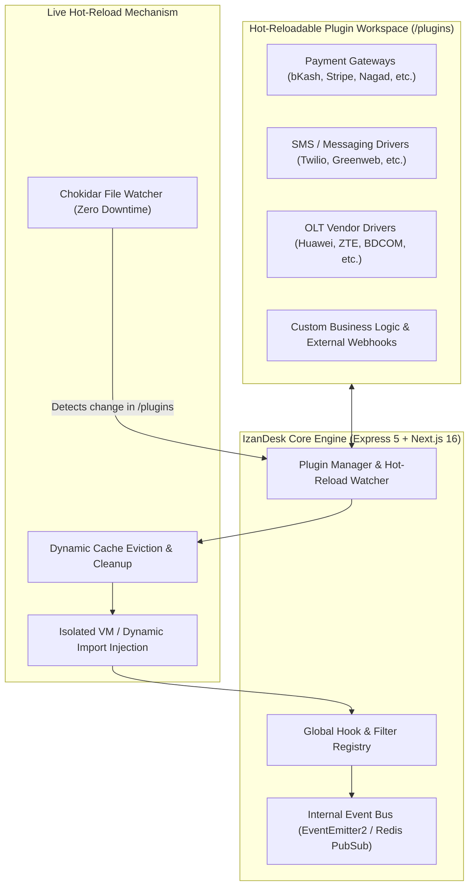

# IzanDesk ERP — 565-Feature Design & Requirements Catalog

**Document Version:** 1.1.0  
**Status:** Design/requirements catalog — not every entry is implemented (see README phases and the roadmap for shipped capability)
**Architecture:** Modular, Event-Driven, Hot-Reloadable Plugin Kernel  

---

## Architecture of Extensibility & Hot-Reload Engine

To ensure IzanDesk is **infinitely extendable without requiring server downtime or restarts**, the platform incorporates the **IzanDesk Dynamic Plugin Kernel**:

- **Zero-Downtime Hot-Reloading**: Drivers for Payment Gateways, SMS Providers, OLT templates, and custom scripts are located in `/plugins/` and loaded dynamically via ES module import cache invalidation. Adding a new payment gateway or router driver does **not** restart the main application.
- **Event-Driven Hook Lifecycle**: Over 120 lifecycle hooks (`subscriber.before_create`, `invoice.after_paid`, `radius.on_auth_reject`, `olt.on_signal_critical`, etc.) allow plugins to intercept and modify behavior without editing core source code.
- **Hot-Swappable Web UI Widgets**: Next.js React Server Components and dynamic micro-frontends allow hot-reloaded UI dashboard cards, custom reports, and settings panels.

---

## Complete Feature Matrix (565 Categorized Features)

> **Status note:** This document is a design/requirements catalog. A feature listed
> here is not necessarily implemented — check the phase status in `README.md` and
> `izandesk_phase_implementation_roadmap.md` for actual shipped capability.

### Domain 1: Subscriber & Customer Lifecycle Management (Features 1 – 40)
1. **Self-Onboarding & Fast Registration**: Automated customer intake wizard with instant duplicate check on NID, phone, and email.
2. **Custom Client Code Generator**: Configurable prefix, zone code, and sequential zero-padded ID (e.g. `IZN-DHK-00042`).
3. **Retail PPPoE Account Provisioning**: Automated creation of PPPoE secrets with CHAP/MS-CHAPv2 authentication.
4. **Static IP / Direct IPoE Provisioning**: Static IP allocation with DHCP Option 82 and ARP/MAC locking.
5. **Hotspot & Guest Wi-Fi Account Manager**: PIN and Voucher-based hotspot accounts with validity and session limits.
6. **Corporate / Leased Line CIR Profiles**: Dedicated symmetrical bandwidth management with burst guarantees and SLA tiers.
7. **Reseller-Assigned Subscriber Profiles**: Segregated client profiles tied to specific reseller credit balances.
8. **Digital KYC & Identity Verification**: Upload and storage of National ID, Passport, Utility bills, and trade licenses.
9. **Customer Photo Capture & WebCam Sync**: In-browser camera capture for customer avatar and registration records.
10. **Interactive Document Expiry Alerts**: Automated notifications when customer lease agreements or trade licenses expire.
11. **Subscriber Status State Machine**: Automated lifecycle transitions (`PENDING`, `ACTIVE`, `GRACE_PERIOD`, `SUSPENDED`, `EXPIRED`, `TERMINATED`).
12. **MAC Address Binding & Anti-Spoofing**: Hard-lock client account to physical ONT/Router MAC address with one-click rebind.
13. **Multiple Service Subscriptions**: Single customer entity capable of holding multiple internet lines (e.g. Home + Office).
14. **Subscriber Service Transfer**: Move an active subscriber from one Zone/POP/Router to another with zero data loss.
15. **Package Upgrade / Downgrade Scheduler**: Schedule package speed changes immediately or on the next billing cycle.
16. **Temporary Speed Boost / Turbo Mode**: Grant temporary bandwidth burst (e.g., +20 Mbps for 6 hours) with micro-billing.
17. **Connection Pause / Vacation Mode**: Temporarily freeze billing and network access for subscribers travelling abroad.
18. **Subscriber Credit Limit Rules**: Configurable postpaid credit limit ceiling before hard network disconnect.
19. **Automated Welcome SMS & Onboarding Email**: Triggered immediately upon client account activation with login credentials.
20. **Client Contract & Terms PDF Generator**: Auto-generates printable legal ISP subscription contracts with digital signature.
21. **Subscriber Tagging & Segmentation**: Custom colored tags (e.g. "VIP", "Defaulter", "Gamer", "Fiber-Vulnerable") for bulk filters.
22. **Subscriber Shift / Move Address Tracking**: Historical log of subscriber physical address modifications and fiber re-termination.
23. **Bulk Client CSV / Excel Import**: Fast CSV importer with validation, field mapping, and rollback capability.
24. **Live MikroTik User Import**: Auto-discover and import existing PPP secrets directly from connected MikroTik routers.
25. **Client Export Engine**: Export filtered subscriber records into Excel, CSV, JSON, or PDF formats with column toggles.
26. **Parent-Child Account Hierarchy**: Link multiple retail subscriber accounts under a corporate parent billing entity.
27. **Client Activity Timeline**: Chronological audit trail of all status changes, package changes, payments, and tickets.
28. **Customer Session History**: Complete log of all past PPPoE / Hotspot login/logout timestamps and IP assignments.
29. **Subscriber Left / Churn Tracking**: Dedicated workflow for churned clients with exit-interview reason logging.
30. **Re-connection Workflow**: One-click re-activation of previously churned clients with past ledger balance restoration.
31. **Subscriber Geolocation Pinning**: Capture exact GPS coordinates (Latitude/Longitude) with draggable map pin.
32. **Nearest Fiber Box Auto-Lookup**: Automatically suggests the closest Distribution Box (TJ/Splitter) based on client GPS.
33. **Customer Language Preference**: Per-subscriber interface and SMS language setting (English, Bengali, Arabic, etc.).
34. **Subscriber Custom Fields**: Dynamic user-defined custom attributes (e.g., Building Name, Flat No, Router Serial).
35. **Customer Device Inventory Link**: Link issued ONTs and Wi-Fi routers directly to the subscriber's asset profile.
36. **IP Conflict Detection**: Real-time validation preventing duplicate static IP assignments across the network.
37. **Customer Notes & Internal Warnings**: Staff-only internal sticky notes displayed prominently on subscriber view.
38. **Blacklisted User Database**: Block fraudulent phone numbers, NIDs, or MAC addresses from re-registering.
39. **Subscriber Quick-Search Engine**: Search by Code, Name, Phone, IP, MAC, PPPoE User, or Box with `Cmd+K` keyboard shortcut.
40. **Multi-Currency Client Support**: Assign custom currency per subscriber for cross-border and multinational ISPs.

---

### Domain 2: Bandwidth & Traffic Management (Features 41 – 75)
41. **Simple Queue Synchronization**: Direct creation and management of MikroTik Simple Queues with target IP/Subnet.
42. **Queue Tree & Mangle Optimization**: Advanced PCQ (Per Connection Queue) bandwidth distribution for ISP backbone.
43. **Symmetrical & Asymmetrical Speed Profiles**: Granular download and upload limits (e.g. 25 Mbps Down / 10 Mbps Up).
44. **Burst Rate Management**: Configurable Burst Threshold, Burst Limit, and Burst Time for faster web page load spikes.
45. **Day / Night Speed Scheduling**: Automated time-of-day speed multipliers (e.g. double speed between 12:00 AM and 08:00 AM).
46. **Fair Usage Policy (FUP) Engine**: Automated bandwidth throttling once a customer exceeds monthly GB volume thresholds.
47. **Multi-Stage FUP Steps**: Tier 1: 50 Mbps (up to 500GB) $\rightarrow$ Tier 2: 25 Mbps (up to 750GB) $\rightarrow$ Tier 3: 10 Mbps.
48. **BDIX (Local IX) Peering Queues**: High-speed dedicated queues for local Internet Exchange traffic (e.g. 100 Mbps BDIX).
49. **CDN & Cache Traffic Shaping**: Dedicated bandwidth allocation for Google, YouTube, Facebook, and Netflix CDN nodes.
50. **Gaming & Low-Latency Priority Queues**: DSCP/TOS traffic prioritization for low-ping gaming traffic.
51. **VoIP & Video Call Traffic Prioritization**: Strict priority queueing for SIP/RTP audio and video conferencing packets.
52. **Top Bandwidth Consumers Monitor**: Real-time dashboard widget displaying the top 10 heaviest downloaders in the network.
53. **Real-time Interface Traffic Poller**: Live Rx/Tx traffic stream fetched every 1–2 seconds via WebSockets without CPU spikes.
54. **Historical Bandwidth Usage Graphs**: 24-hour, 7-day, 30-day, and 1-year historical MRTG-style bandwidth telemetry graphs.
55. **Per-Subscriber Live Traffic Graph**: Live speedometer and area chart for individual subscriber sessions on demand.
56. **Data Volume Quota Tracking**: Metered billing tracking total bytes transferred (In / Out / Total GB).
57. **Quota Top-Up Purchases**: Allow subscribers to purchase extra data volume packages when their monthly quota runs out.
58. **Traffic Accounting Aggregator**: Periodic roll-up of accounting octets into hourly and daily summary tables.
59. **Packet Loss & Jitter Telemetry**: Continuous ping sampling to measure subscriber connection quality and packet loss.
60. **Torrent / P2P Throttling Policies**: Dynamic connection limiting on peer-to-peer protocols during peak hours.
61. **DNS-Based Filtering Rules**: Block malicious phishing domains and illegal sites at the router DNS / Layer 7 level.
62. **Dynamic Address List Allocation**: Place subscribers into MikroTik Address Lists based on status (e.g. `VIP`, `Overdue`).
63. **ICMP Latency Heatmap**: Visual network latency heatmap highlighting degraded sectors or wireless AP links.
64. **Shared Bandwidth Pools**: Group multiple branches or home subscribers under a shared bandwidth cap.
65. **Time-Based Bandwidth Scheduling Rules**: Dynamic cron scheduler executing custom RouterOS queue modification scripts.
66. **CIR (Committed Information Rate) Guarantees**: Enforce strict minimum guaranteed speeds for mission-critical enterprise links.
67. **MIR (Maximum Information Rate) Caps**: Enforce absolute speed ceilings during network congestion periods.
68. **Bandwidth Pool Rollover**: Rollover unused GB quotas into the next billing month for retail prepaid accounts.
69. **Speedtest Integration**: Integrated HTML5 speedtest server directly accessible from the customer portal.
70. **Bandwidth Alert Thresholds**: Trigger proactive email/Telegram alerts when router uplink capacity exceeds 85%.
71. **Connection Rate Limiting**: Mitigate SYN-flood attacks by capping maximum concurrent TCP connections per IP.
72. **Custom Queue Types (SFQ, RED, PCQ)**: Selection of advanced packet queueing disciplines for network engineers.
73. **Bandwidth Package Cloning**: Fast 1-click duplication of existing complex bandwidth and burst profiles.
74. **Package Expiry Behavior Rules**: Define whether speed drops to 512 Kbps or fully disconnects upon subscription expiry.
75. **Bypass / White-List Traffic**: Exclude billing portal and local payment gateway IP ranges from data quota counters.

---

### Domain 3: Carrier-Grade AAA & FreeRADIUS Engine (Features 76 – 110)
76. **FreeRADIUS 3.2 Native Integration**: Direct synchronization between PostgreSQL and FreeRADIUS `radcheck`/`radreply` tables.
77. **Dynamic CoA (Change of Authorization)**: Real-time speed upgrades and profile switches without terminating active PPP sessions.
78. **PoD (Packet of Disconnect)**: RFC 3576 instant session termination packet sent directly to NAS routers on auto-suspend.
79. **RADIUS Accounting Engine (radacct)**: High-performance session tracking for start, stop, interim-update, and octet counts.
80. **Interim Update Interval Configuration**: Configurable accounting packet frequency (e.g. every 300 seconds).
81. **Simultaneous-Use Enforcement**: Block dual concurrent logins with the same username across different NAS routers.
82. **Dynamic Framed-IP-Address Injection**: Assign dedicated static public/private IPs directly from RADIUS reply attributes.
83. **Dynamic Framed-Route Push**: Inject static routing subnets to enterprise customers upon PPPoE tunnel establishment.
84. **Dynamic Framed-Pool Assignment**: Assign dynamic IP pools based on package or zone (e.g. `Pool-Mirpur-50M`).
85. **Mikrotik-Rate-Limit Attribute Builder**: Automated generation of `Rate-Limit = "20M/10M 30M/15M 15M/8M 10/10 8 10M/5M"`.
86. **Mikrotik-Group Attribute Sync**: Dynamically assign subscribers to RouterOS User Groups or Hotspot Server Profiles.
87. **Filter-Id Redirection**: Push firewall filter rules dynamically through RADIUS to isolate non-paying subscribers.
88. **Walled-Garden Redirect Attribute**: Forward suspended subscribers to captive payment portals via RADIUS attributes.
89. **RADIUS Failover & Redundancy**: Multi-server master-slave RADIUS clustering with automatic secondary failover.
90. **NAS Client Management**: Add, edit, and configure Network Access Server (NAS) clients with shared secret encryption.
91. **NAS Vendor Dictionary Support**: Built-in support for MikroTik, Cisco, Huawei, Juniper, and ZTE RADIUS dictionaries.
92. **Session Timeout Rules**: Auto-expire temporary hotspot and daily guest sessions via `Session-Timeout` attributes.
93. **Idle Timeout Rules**: Automatically disconnect inactive subscriber sessions via `Idle-Timeout` attributes.
94. **Acct-Terminate-Cause Analytics**: Log and analyze disconnect causes (User-Request, Lost-Carrier, NAS-Reboot, Admin-Reset).
95. **Live Online Sessions Monitor**: Real-time list of all active sessions across all NAS routers with duration and IP.
96. **RADIUS Authentication Log**: Real-time stream of `Access-Request`, `Access-Accept`, and `Access-Reject` events with failure reasons.
97. **Failed Login Inspector**: Drill-down inspector highlighting incorrect passwords, invalid MAC, or disabled accounts.
98. **RADIUS Test Tool**: Built-in simulated `radtest` authentication tester from the admin web dashboard.
99. **DHCP / IPoE RADIUS Support**: RADIUS authentication for IPoE subscribers using DHCP Option 82 circuit/remote IDs.
100. **IPv6 Delegated-Prefix (Framed-IPv6-Prefix)**: Allocate `/64` or `/56` IPv6 subnets to subscribers via RADIUS AAA.
101. **IPv6 Neighbor Discovery (ND) Support**: RADIUS attributes for dual-stack IPv4/IPv6 subscriber onboarding.
102. **Custom RADIUS Attributes Editor**: GUI editor to add bespoke vendor-specific attributes (VSA) to any package.
103. **RADIUS Database Purge Routine**: Automated cleanup and archival of old `radacct` records beyond retention limits.
104. **Ghost Session Cleaner**: Periodic reconciliation job detecting and flushing dead sessions from the database.
105. **RADIUS Health Telemetry**: Monitor RADIUS server CPU, auth request rate per second, and database query latency.
106. **COA Response Validator**: Verifies ACK/NAK responses from NAS routers after issuing speed adjustment commands.
107. **EAP-TTLS / PEAP Enterprise Wi-Fi**: Enterprise authentication for high-security corporate campus Wi-Fi networks.
108. **Emergency Local Auth Fallback**: Automatic local caching allowing routers to authenticate users during link outages.
109. **Mac-Auth-Bypass (MAB)**: Authenticate devices (e.g. Smart TVs, Printers) without login prompts based on MAC address.
110. **Custom Auth Rejection Messages**: Display customized error messages on hotspot captive portals upon failed logins.

---

### Domain 4: MikroTik RouterOS Automation (Features 111 – 145)
111. **Multi-Router Management**: Centralized management of unlimited MikroTik CCR, CHR, and RB routers.
112. **RouterOS v6 & v7 Full Compatibility**: Native support for both legacy RouterOS v6 and modern RouterOS v7 architectures.
113. **Dual Connection Protocols**: Support for both RouterOS API (port 8728/8729 SSL) and modern RouterOS v7 REST API.
114. **Auto Connection Health Heartbeat**: Background ping and API ping checking router reachability every 30 seconds.
115. **Router Resource Telemetry**: Real-time CPU load, RAM usage, HDD storage, temperature, and uptime monitoring.
116. **One-Click Router Reboot**: Secure administrative remote reboot with two-factor authorization confirmation.
117. **PPP Secret Synchronization**: Automated creation, modification, and deletion of `/ppp secret` entries.
118. **PPP Active Connection Kick**: Instantly terminate any active PPP session directly from the client management view.
119. **PPP Profile Manager**: Create and sync `/ppp profile` with local address, remote address, and DNS settings.
120. **PPPoE Service Server Config**: Configure and monitor `/interface pppoe-server server` interfaces.
121. **Hotspot Server Automation**: Manage `/ip hotspot` servers, user profiles, and captive portal HTML pages.
122. **Firewall Filter Rules Automation**: Inject security and isolation rules directly into `/ip firewall filter`.
123. **Firewall Address List Manager**: Dynamically push IP addresses to `/ip firewall address-list` with custom timeouts.
124. **Firewall NAT & Port Forwarding**: Manage `/ip firewall nat` rules for corporate client public IP mapping.
125. **Interface Traffic Telemetry**: Monitor traffic rates, packet errors, and drops across all Ethernet and SFP+ interfaces.
126. **IP Pool Synchronizer**: View and allocate subnets from MikroTik `/ip pool` directly in the ERP interface.
127. **DHCP Server & Leases Viewer**: View active `/ip dhcp-server lease` entries with hostname and expiry timer.
128. **DNS Cache & Static Entries**: Configure `/ip dns` static entries for intranet redirection and captive portal routing.
129. **IP Route Manager**: View routing table `/ip route` and inject static gateways for enterprise corporate clients.
130. **SNMP Agent Configurator**: Remotely set SNMP community strings and contact parameters on managed routers.
131. **MikroTik Script & Scheduler Runner**: Deploy and execute RouterOS scripts and cron scheduler tasks remotely.
132. **System Log Streamer**: Stream live `/log print` messages directly to the IzanDesk NOC console.
133. **RouterOS Backup Manager**: Automated scheduled daily backup (`.backup` and `.rsc` export) downloaded to cloud storage.
134. **RouterOS Backup Restore Tool**: Re-apply previous configuration scripts directly from the IzanDesk web console.
135. **RouterOS Firmware Upgrade Assistant**: Detect RouterOS software updates and trigger automated upgrades.
136. **ARP Table Inspector**: View physical MAC-to-IP pairings in `/ip arp` with search and conflict detection.
137. **Neighbor Discovery Table (MNDP/CDP)**: View connected neighboring network switches, OLTs, and routers.
138. **Ping & Traceroute Diagnostic Utility**: Run live ping and traceroute directly from the router to any destination IP.
139. **Bandwidth Test (BTest) Tool**: Run internal TCP/UDP bandwidth tests between two managed MikroTik routers.
140. **Torch Network Packet Inspector**: Real-time protocol, port, and IP traffic analysis on any selected interface.
141. **Connection Tracking Table Viewer**: Monitor active `/ip firewall connection` entries and high-connection IPs.
142. **WireGuard / OVPN Tunnel Orchestrator**: Automatically create site-to-site VPN tunnels for remote branch offices.
143. **VLAN Interface Manager**: Create and manage `/interface vlan` tags across trunk and access ports.
144. **BGP Peer Monitoring**: Monitor BGP session state (Established, Idle), received prefix count, and uptime.
145. **Router Template Deployment**: 1-Click zero-touch initial configuration script generation for new MikroTik routers.

---

### Domain 5: FTTH, OLT & PON Management (Features 146 – 180)
146. **Multi-Vendor OLT Support**: Built-in support for Huawei, BDCOM, ZTE, CDATA, VSOL, HSGQ, ATOP, and Fiberhome OLTs.
147. **Dual Telemetry Protocol (SNMP + CLI)**: High-speed SNMP v2c/v3 polling combined with Telnet/SSH CLI command execution.
148. **GPON / EPON / XGS-PON Support**: Comprehensive management across legacy EPON and modern GPON/10G architectures.
149. **Unconfigured / Auto-Find ONU Discovery**: Real-time listener for newly connected, unapproved ONUs/ONTs.
150. **1-Click ONU Authorization**: Instantly authorize an unconfigured ONU, bind it to a subscriber, and push line profiles.
151. **Optical Power (Rx/Tx dBm) Telemetry**: Continuous polling of optical signal strength at both the OLT and ONU optical transceivers.
152. **Optical Signal Degradation Alert**: Automated alerts when subscriber optical power drops below warning threshold (e.g. -26 dBm).
153. **Critical Fiber Break Alert**: Instant notification when optical Rx drops to `-40 dBm` (LOS - Loss of Signal).
154. **PON Port Capacity Visualizer**: Visual dashboard displaying connected ONUs vs. max port capacity (e.g. 48/64 ONUs).
155. **PON Port Optical Budget Calculator**: Calculates theoretical optical loss budget based on splitters and fiber distance.
156. **Remote ONU Reboot**: Send remote reboot command to customer ONT directly from the client management screen.
157. **Remote ONU Factory Reset**: Reset customer ONT to default factory configuration via OLT OMCI/OAM.
158. **ONU Port Status & Link State**: Check status (Up/Down), speed (100M/1G), and duplex on the customer-facing LAN ports.
159. **ONU Catv / RF Port Management**: Remotely enable or disable CATV optical video overlay port on supported triple-play ONUs.
160. **ONU Distance from OLT (Timing Advance)**: Measure the exact physical fiber cable distance in meters to the customer's ONT.
161. **OLT Temperature & Fan Sensor Telemetry**: Continuous thermal monitoring of OLT fan speeds, power supplies, and chassis temperature.
162. **OLT MAC Address Table Cache**: High-speed cached database of all MAC addresses learned across every PON port and VLAN.
163. **Rogue ONU Detection**: Detects and isolates malfunctioning ONUs transmitting continuous unslotted upstream light.
164. **VLAN & Service Port (GEM Port) Mapping**: Automatically configure VLAN tagging (Access, Trunk, Translation) on PON ports.
165. **OLT Uplink SFP+ Interface Telemetry**: Monitor uplink port traffic, SFP laser bias current, and optical transmit levels.
166. **ONU Firmware Bulk Upgrade Manager**: Schedule overnight bulk firmware updates for customer ONUs over OMCI.
167. **DBA (Dynamic Bandwidth Allocation) Profile Manager**: Configure upstream bandwidth allocation profiles on the OLT.
168. **Line Profile & Service Profile Templates**: Pre-configured templates for 1-click deployment of new OLT hardware.
169. **ONU Optical Power History Chart**: 30-day graphical trend of optical signal fluctuations to diagnose fiber degradation.
170. **Splitter Attenuation Inspector**: Pinpoint dirty fiber connectors or faulty splitters causing uneven power drops.
171. **OLT Configuration Backup Engine**: Automated daily CLI script backup saved to secure encrypted cloud storage.
172. **Telnet / SSH In-Browser Terminal**: Direct secure web terminal allowing NOC engineers to run raw CLI commands on OLTs.
173. **ONU WiFi Status Inspector**: Check whether the customer's built-in ONT Wi-Fi radio is currently enabled or disabled.
174. **Multi-Chassis OLT Stacking View**: Unified dashboard view for large multi-slot modular chassis (e.g. Huawei MA5608T / MA5800).
175. **PON Port Bandwidth Utilization**: Live throughput monitoring per physical PON port to detect oversubscribed fibers.
176. **De-authorized ONU Quarantine Table**: Manage blocked or stolen ONUs to prevent unauthorized connection to the fiber tree.
177. **ONU Serial Number / MAC Batch Importer**: Pre-register inventory batches of ONUs before field deployment.
178. **Fiber Cut Alarm Clustering**: AI-driven clustering of multiple simultaneous LOS alarms to pinpoint the exact trunk fiber break.
179. **OLT Power Supply Redundancy Monitor**: Alert if dual AC/DC power supplies fail or switch to backup battery power.
180. **Hot-Reloadable OLT Vendor Driver API**: Dynamically add new OLT brands and CLI parsing templates without restarting the server.

---

### Domain 6: TR-069 / CWMP / GenieACS CPE Management (Features 181 – 210)
181. **GenieACS NBI (Northbound Interface) Integration**: Direct REST API integration with carrier-grade GenieACS servers.
182. **Zero-Touch Wi-Fi Provisioning (ZTP)**: Auto-configures customer Wi-Fi router immediately upon plug-and-play connection.
183. **Remote Wi-Fi SSID Name Modification**: Change customer 2.4GHz / 5GHz Wi-Fi names directly from admin or client portal.
184. **Remote Wi-Fi Password Reset**: Securely change customer WPA2/WPA3 Wi-Fi passwords with instant device sync.
185. **Dual-Band (2.4GHz / 5GHz) Radio Control**: Manage channel selection, channel width (20/40/80 MHz), and transmit power.
186. **Connected Wi-Fi Clients Inspector**: View list of all smartphones, laptops, and smart TVs connected to customer's home Wi-Fi.
187. **Connected Client Signal Strength (RSSI)**: Check whether customer devices suffer from weak Wi-Fi signal in remote rooms.
188. **Remote CPE Reboot**: Issue CWMP RPC Reboot command to customer home router without field technician visit.
189. **Remote CPE Factory Reset**: Remotely restore customer CPE to baseline ISP settings.
190. **WAN Interface Remote Reconfiguration**: Modify PPPoE credentials, MTU size, and VLAN tags on customer WAN port.
191. **DNS Server Push**: Push fast DNS servers (e.g. local ISP DNS or Cloudflare 1.1.1.1) to all customer routers.
192. **LAN DHCP Subnet Management**: Configure customer local IP address range (e.g. `192.168.1.1/24`) and lease times.
193. **CPE Firmware Over-The-Air (FOTA) Engine**: Schedule mass automated firmware updates across thousands of home routers.
194. **Router Hardware Information & Uptime**: Real-time display of customer router manufacturer, model, serial, and uptime.
195. **CPE CPU & RAM Utilization Monitor**: Identify underperforming customer routers freezing due to memory exhaustion.
196. **Wi-Fi Interference & Neighboring AP Scanner**: Scan surrounding Wi-Fi channels to auto-select the cleanest frequency.
197. **Parental Controls & Content Filtering**: Toggle adult content filtering and gambling domain blocks on customer request.
198. **Guest Wi-Fi Network Provisioning**: Remotely enable an isolated guest Wi-Fi SSID with custom bandwidth limits.
199. **WPS (Wi-Fi Protected Setup) Remote Toggle**: Disable vulnerable WPS protocols on customer routers for security hardening.
200. **IPv6 WAN/LAN Dual-Stack Provisioning**: Configure DHCPv6-PD (Prefix Delegation) on customer CPE automatically.
201. **Port Forwarding (Virtual Server) Rules**: Remotely open ports for customer security cameras, NVRs, or gaming consoles.
202. **Dynamic DNS (DDNS) Remote Config**: Configure DDNS providers (No-IP, DynDNS) on customer routers.
203. **CPE Configuration Backup & Diff**: Save customer router XML configuration backups and compare changes over time.
204. **Device Periodic Inform Interval Control**: Tune the heartbeat inform interval (e.g. 3600 seconds) to balance server load.
205. **Firewall & SPI Remote Settings**: Enable/disable stateful packet inspection and ping reply on customer WAN interface.
206. **TR-181 & TR-098 Data Model Support**: Comprehensive compatibility across both legacy and modern broadband data models.
207. **Real-Time CWMP Fault Logging**: Instant capture of RPC faults and parameter write failures with detailed error codes.
208. **Speedtest Execution from CPE**: Trigger speedtest directly from customer router to ISP speedtest server to isolate Wi-Fi issues.
209. **Device Parameter Search & Raw Inspector**: Inspect any raw TR-069 parameter tree (`InternetGatewayDevice.*`).
210. **Hot-Reloadable CWMP Provisioning Scripts**: Modify ZTP provisioning rules on the fly with instant reload.

---

### Domain 7: IPAM (IP Address Management) & Subnetting (Features 211 – 235)
211. **IPv4 Subnet Calculator & Hierarchical Tree**: Visual IP tree displaying `/8` down to `/32` subnet allocations.
212. **IPv6 Prefix Management**: Carrier-grade management for IPv6 `/32`, `/48`, `/56`, and `/64` subnets.
213. **Public & Private IP Pool Segregation**: Separate pools for CGNAT (Carrier-Grade NAT) and dedicated Public IPs.
214. **IP Pool Utilization Bar & Warning Alerts**: Visual percentage bar triggering alerts when an IP pool reaches 90% capacity.
215. **Static IP Assignment Workflow**: Reserve and assign dedicated static IPs to corporate and retail customers.
216. **Subnet Conflict & Overlap Prevention**: Automatic validation engine preventing overlapping subnet definitions.
217. **CGNAT Logging & BTRC Legal Compliance**: High-performance logging of translation mappings (Private IP + Port $\rightarrow$ Public IP).
218. **BTRC NAT Log Retention Engine**: Stores timestamped NAT translation sessions for 1–2 years for regulatory audit requests.
219. **Quick IP Search & Reverse Lookup**: Search any IP address to instantly identify the assigned subscriber, MAC, and router.
220. **VLAN IP Subnet Binding**: Map dedicated subnets to specific customer VLAN tags.
221. **Gateway & DNS Pool Defaults**: Define primary, secondary, and gateway addresses per subnet.
222. **Blacklisted IP Reputation Checker**: Automated daily check against spam blacklists (Spamhaus, Barracuda) for public IP blocks.
223. **IP Freeze / Quarantine Period**: Keep churned static IPs in quarantine for 7 days before re-assigning to new customers.
224. **Reverse DNS (PTR) Record Manager**: Manage and export PTR records for corporate clients running private mail servers.
225. **BGP ASN & Peering IP Tracker**: Track upstream transit provider IP allocations and BGP peering subnets.
226. **Loopback IP Management**: Centralized management of loopback (`/32`) IP addresses for network routers and switches.
227. **Management Subnet Isolation**: Dedicated IP pools reserved exclusively for OLTs, switches, and core network hardware.
228. **Dynamic IP Leases Viewer**: Real-time view of all currently leased dynamic IPs across all pools.
229. **IP Utilization Heatmap**: Visual grid showing used, free, reserved, and quarantined IP addresses in a subnet.
230. **Subnet Import & Export Utility**: Bulk import existing IP address spreadsheets with validation.
231. **Custom IP Allocation Tags**: Tag subnets with custom labels (e.g. "Banking-Clients", "Hospital-Network", "Hotspot-Pool").
232. **Automated IP Release upon Churn**: Automatically returns static IPs to the free pool when a customer contract is cancelled.
233. **Secondary Subnet Binding**: Assign multiple non-contiguous IP blocks to a single corporate client interface.
234. **DHCP Option 82 Subnet Binding**: Allocate subnets strictly based on the physical fiber switch port ID.
235. **IP Assignment Audit Trail**: Permanent log recording exactly who held any IP address at any historical second.

---

### Domain 8: Automated Billing, Invoicing & Due Policies (Features 236 – 280)
236. **Automated Monthly Invoicing Engine**: High-speed batch invoice generator creating 50,000+ invoices in seconds.
237. **Calendar-Month Billing Cycle**: Invoices run from the 1st of the month to the last day, with generation on the 1st.
238. **Anniversary (30-Day) Billing Cycle**: Billing period calculated exactly 30 days from client activation date.
239. **Prorated First Month Invoicing**: Automatically calculate exact daily prorated amount for subscribers joining mid-month.
240. **Prepaid Billing Model**: Service is rendered only after payment is received; auto-suspends on expiry date.
241. **Postpaid Billing Model**: Service runs for the month; invoice issued at month-end with custom payment due date.
242. **Corporate CIR Invoicing**: Custom corporate invoices supporting multi-line items, static IP rental, and equipment lease.
243. **Automated Due Date Reminder Triggers**: Configurable SMS and WhatsApp alerts sent 5 days, 3 days, and 1 day before due date.
244. **Configurable Grace Period Engine**: Allow 1 to 5 days of internet access after expiry date before enforcing suspension.
245. **Multi-Stage Auto-Suspend Engine**: Automatically isolates non-paying clients immediately after grace period expires.
246. **Instant Auto-Reactivation**: Automatically removes suspension and restores full bandwidth within 2 seconds of payment.
247. **Walled Garden Redirection**: Route suspended subscribers to captive payment portal with one-click payment buttons.
248. **Permanent Monthly Discounts**: Configurable recurring discount (percentage or fixed amount) applied to regular monthly bill.
249. **One-Off Waivers & Adjustments**: Staff-approved bill adjustments (e.g. compensation for extended fiber cut downtime).
250. **Late Payment Fee Penalty**: Automated fixed or percentage penalty added to invoices remaining unpaid past the due date.
251. **Advance Payment & Credit Balance**: Allow subscribers to pay multiple months in advance, stored as customer credit.
252. **Auto-Deduction from Advance Balance**: Monthly invoice automatically marked PAID by drawing down from customer credit.
253. **Partial Payment Acceptance**: Allow subscribers to pay partial amounts; remaining balance tracked as outstanding due.
254. **Tax / VAT / AIT Engine**: Multi-rate tax engine (e.g. 5% Internet VAT + 10% AIT) with compliant breakdown on invoices.
255. **Customizable Invoice PDF Templates**: Modern HTML/CSS printable invoice templates with company logo and QR codes.
256. **QR-Code Invoice Scanning**: Embedded dynamic payment QR code on invoices for fast mobile payment scanning.
257. **Bulk Invoice Printing Utility**: Print hundreds of formatted invoices at once for door-to-door bill collectors.
258. **Thermal POS Receipt Printer Support**: Print 58mm / 80mm mini receipts instantly on field bill collector portable printers.
259. **Door-to-Door Collector Daily Sheet**: Generate assigned daily cash collection routes with customer phone and due amount.
260. **Collector Cash Settlement & Handover**: Formal workflow for bill collectors to hand over cash collections to head cashier.
261. **Invoice Cancellation & Voiding**: Secure permission-controlled invoice voiding with mandatory reason logging.
262. **Due Analytics & Aging Report**: Breakdown of outstanding dues by aging buckets (0–30 days, 31–60 days, 60+ days).
263. **Due Report by Router & Zone**: Multi-dimensional matrix showing total outstanding debt per router and geographic area.
264. **Customer Ledger Statement**: Complete running ledger statement showing debits, credits, and balance over any date range.
265. **Automated Money Receipt Generator**: Instant digital money receipt generated and sent via SMS/Email upon payment.
266. **Refund Management**: Formal processing and recording of security deposit or overpayment refunds.
267. **Corporate Quotation / Pro-Forma Invoice**: Generate pro-forma quotations for prospective corporate clients.
268. **Multiple Currency Invoicing**: Issue invoices in BDT, USD, EUR, GBP with automatic exchange rate conversion.
269. **BTRC Revenue Share Report**: Automated monthly report calculating regulatory revenue share deductions.
270. **Upstream NTTN & IIG Expense Invoicing**: Track and record incoming bandwidth and transmission bills from upstream carriers.
271. **Bill Adjustment Audit Trail**: Permanent record of every staff member who modified, discounted, or waived a bill.
272. **Bad Debt Write-Off Workflow**: Move uncollectible aged debts to bad debt expense ledger upon management approval.
273. **Bulk SMS to Unpaid Subscribers**: Filter all currently unpaid clients with one click and dispatch custom payment reminder.
274. **Payment Reminder Robocall Integration**: Trigger automated voice call reminders via VoIP Asterisk/FreePBX integration.
275. **Credit Note & Debit Note Issuance**: Formal accounting credit and debit notes tied to original invoice numbers.
276. **Annual Subscription Billing**: Special discounted 12-month prepaid package plans with automated yearly renewal.
277. **Micro-Billing for Hotspot Vouchers**: Instant generation and pricing of 1-hour, 24-hour, and 7-day hotspot voucher cards.
278. **Auto-Lock Billing Settings**: Prevent unauthorized edits to finalized historical billing months.
279. **Invoice Duplicate Detection**: System safeguard preventing double-generation of invoices for the same subscriber month.
280. **Hot-Reloadable Billing Rule Plugins**: Add customized regional billing calculations and holiday extensions dynamically.

---

### Domain 9: Payment Gateways & MFS Integration (Features 281 – 315)
281. **bKash Tokenized Checkout**: Seamless one-click recurring payment using bKash Tokenized API with auto-reconnection.
282. **bKash Merchant Payment (PGW)**: Standard URL-redirect bKash checkout with instant server-to-server webhook verification.
283. **Personal bKash SMS Webhook Listener**: Android app listens to incoming payment SMS on personal bKash SIM and auto-approves bills.
284. **Nagad Direct Merchant Checkout**: Full integration with Nagad payment gateway API for instant automated bill clearing.
285. **Personal Nagad SMS Webhook Listener**: Automated parsing of Nagad personal cash-in and send-money transaction SMS.
286. **Rocket (DBBL) Merchant Gateway**: Automated bill payment clearing via Dutch-Bangla Bank Rocket payment gateway.
287. **SSLCommerz Multi-Channel Gateway**: Accepts all local Visa, MasterCard, Amex, and Internet Banking cards through SSLCommerz.
288. **Shurjopay Payment Gateway**: Alternative Bangladeshi payment aggregator driver.
289. **AamarPay Payment Gateway**: Fast local merchant payment aggregator integration.
290. **Stripe Checkout & Elements**: Global credit card processing supporting Apple Pay, Google Pay, and 3D Secure 2.0.
291. **Stripe Automated Recurring Billing**: Store customer payment methods securely in Stripe Vault for automated monthly charging.
292. **PayPal Smart Payment Buttons**: Accept PayPal balances and international credit cards for overseas/expat subscribers.
293. **M-Pesa Mobile Money (STK Push)**: Direct mobile payment push prompt on customer phones for East African deployments.
294. **Razorpay Payment Gateway**: Comprehensive card, UPI, and net-banking integration for South Asian markets.
295. **Paystack Payment Gateway**: Card and mobile money processing for African ISP markets.
296. **Offline Cash Payment Processing**: Instant manual cash collection recording with cashier drawer tracking.
297. **Bank Wire & Cheque Clearance Workflow**: Record cheque deposits with clearance date and bank transaction reference.
298. **Duplicate TrxID Fraud Prevention**: System-wide cryptographic safeguard rejecting any reused payment transaction ID.
299. **Payment Webhook Signature Validation**: Verify HMAC SHA-256 signatures on all incoming webhooks to prevent spoofing.
300. **Automated Webhook Retry Queue**: Failed payment webhooks are automatically retried with exponential backoff via BullMQ.
301. **TrxID Manual Matcher Utility**: Admin search tool to manually assign unmatched incoming payments to specific subscriber bills.
302. **Gateway Surcharge & Fee Handling**: Configurable rule to absorb or pass gateway transaction fees (e.g. 1.5%) to customer.
303. **Instant Payment Notification (IPN)**: Webhook engine broadcasting verified payments to internal microservices and accounting.
304. **Automated Receipt SMS on Payment**: Immediate SMS dispatched upon payment confirmation with TrxID and remaining balance.
305. **Customer Payment History Ledger**: Searchable payment log in customer portal displaying all past digital receipts.
306. **POS Terminal Card Swipe Integration**: Record payments made via physical EDC bank POS terminal machines.
307. **Overpayment Wallet Crediting**: Excess payments automatically credited to customer internal wallet for next month's bill.
308. **Payment Gateway Health Monitor**: Tracks gateway API uptime, latency, and success rates, alerting staff if a gateway fails.
309. **Multi-Gateway Failover Routing**: Automatically route customer to secondary gateway if the primary gateway is offline.
310. **Daily Gateway Settlement Reconciliation**: Compare gateway payout reports against IzanDesk payment logs to detect discrepancies.
311. **Refund Transaction Processing**: Issue full or partial refunds directly back to customer gateway source where supported.
312. **Corporate Escrow & Deposit Handling**: Track corporate refundable security deposits separately from operational revenue.
313. **Crypto Payment Adapter (USDT/BTC)**: Optional driver for accepting cryptocurrency payments for international leased lines.
314. **Personal Payment Number Rotator**: Dynamically rotate multiple personal bKash/Nagad numbers to stay within daily SIM limits.
315. **Hot-Reloadable Payment Driver API**: Add any new bank or regional payment gateway driver without taking the server down.

---

### Domain 10: Multi-Tier Reseller & Franchisee System (Features 316 – 350)
316. **Multi-Tier Hierarchy Engine**: Super Admin $\rightarrow$ Master Franchise $\rightarrow$ Sub-ISP / Reseller $\rightarrow$ Sub-Reseller $\rightarrow$ End User.
317. **Prepaid Wallet Architecture**: Resellers operate on a dedicated prepaid wallet that must have funds to activate clients.
318. **Online Reseller Wallet Recharge**: Resellers can recharge their wallet balance instantly using bKash, Nagad, or Stripe.
319. **Manual Bank Transfer Recharge Request**: Resellers submit bank slip photos for admin verification and balance credit.
320. **Wholesale Package Rate Cards**: Super Admin sets custom wholesale buying rates per package for each individual reseller.
321. **Reseller Retail Margin Freedom**: Resellers define their own retail selling prices to their end-users, pocketing the profit.
322. **Automated Wallet Deduction on Renewal**: Monthly subscriber renewal automatically deducts the wholesale rate from reseller wallet.
323. **Insufficient Balance Auto-Block**: Prevents package renewals or new activations if reseller prepaid wallet has insufficient balance.
324. **Reseller Credit Limit & Overdraft**: Configurable credit ceiling allowing trusted resellers to operate up to a negative balance limit.
325. **Reseller Client Data Isolation**: Strict tenant isolation ensuring resellers can only view and manage their own assigned clients.
326. **White-Label Reseller Web Portal**: Resellers get a branded portal with their own company name, logo, and contact info.
327. **Reseller Custom Subdomain Routing**: Support for reseller custom subdomains (e.g. `fastnet.izandesk.com`).
328. **Reseller Independent SMS Sender ID**: Resellers can use their own registered alphanumeric SMS Sender ID for client alerts.
329. **Reseller Subscriber Creation Permissions**: Granular permissions controlling whether a reseller can add, edit, or delete clients.
330. **Reseller MikroTik Router Assignment**: Restrict resellers to specific MikroTik routers or allow shared access across core routers.
331. **Reseller Dedicated IP Pool Allocation**: Assign dedicated public or private IP pools exclusively for a reseller's subscribers.
332. **Reseller Bandwidth Cap (Bulk CIR)**: Cap total aggregated bandwidth a reseller can sell across all their clients (e.g. 500 Mbps total).
333. **Reseller Real-Time Bandwidth Monitor**: Live aggregate bandwidth graph displaying the combined traffic of all reseller clients.
334. **Reseller Commission Settlement**: Automated calculation of reseller sales commissions with monthly settlement payouts.
335. **Reseller Ledger & Statement**: Running ledger detailing all recharges, client deductions, adjustments, and current balance.
336. **Reseller Ticket Management**: Reseller staff can open tickets on behalf of their clients or escalate issues to Super Admin.
337. **Reseller Client Expiry Calendar**: Visual monthly calendar highlighting which reseller clients are expiring on each date.
338. **Reseller Bulk Client Renewal**: One-click bulk renewal tool allowing resellers to renew dozens of clients simultaneously.
339. **Reseller Staff Sub-Accounts**: Resellers can create sub-accounts for their own bill collectors and support technicians.
340. **Reseller Activity Audit Trail**: Comprehensive log recording every action taken by reseller accounts.
341. **Franchise Profit Sharing Engine**: Automated split-revenue calculation between master franchise and localized sub-ISPs.
342. **Reseller Client Transfer Workflow**: Admin tool to transfer subscribers between different resellers or migrate them to direct retail.
343. **Reseller Expiry Warning Notifications**: Automated alerts to resellers when their wallet balance drops below safe operating threshold.
344. **Reseller Custom Printed Invoices**: Printable invoices featuring the reseller's brand header while powered by IzanDesk backend.
345. **Reseller API Access**: Secure REST API token allowing large sub-ISPs to integrate their external software with IzanDesk.
346. **Reseller Zone & Box Restriction**: Restrict resellers to specific geographic distribution boxes and fiber cables.
347. **Reseller Churn & Retention Analytics**: Analytics dashboard highlighting reseller client retention and monthly growth rates.
348. **Reseller Contract & License Tracker**: Track reseller ISP operational licenses, trade licenses, and legal contracts.
349. **Reseller Account Freezing**: Instantly suspend a defaulting reseller account and all their downstream subscribers with one click.
350. **Hot-Reloadable Reseller Commission Drivers**: Add custom revenue-sharing rules and tiered bonus structures dynamically.

---

### Domain 11: Support CRM, Ticketing & Field Operations (Features 351 – 385)
351. **SLA-Driven Ticketing Engine**: Configurable Service Level Agreement (SLA) timers with automated urgency escalation.
352. **Multi-Channel Ticket Ingestion**: Tickets created via Customer Web Portal, Mobile PWA, Phone Call, or Staff Console.
353. **Smart Auto-Assignment Algorithm**: Automatically assign tickets to the nearest on-duty technician based on client zone.
354. **Ticket Categorization & Taxonomy**: Granular categories: Fiber Cut, Optical Degradation, Router Config, Billing Query, Shift Line.
355. **Priority Severity Levels**: Critical (Core Outage), High (Corporate Down), Medium (Retail Outage), Low (Billing Question).
356. **Technician Mobile Field View**: Responsive mobile screen designed for field technicians working on utility poles with one hand.
357. **Turn-by-Turn GPS Navigation**: One-click Google Maps / OpenStreetMap navigation button directly to client residence pin.
358. **On-Site Optical Power Check**: Technicians can query live optical Rx power directly from their phone without calling NOC.
359. **Before & After Photo Upload**: Technicians capture and attach photos of newly spliced fiber or replacement ONT on-site.
360. **Customer Digital Signature on Ticket**: Customer signs on technician's mobile touchscreen to confirm service restoration.
361. **Ticket Resolution Timer & Metrics**: Tracks exact Mean Time to Detect (MTTD) and Mean Time to Resolve (MTTR).
362. **Automated Ticket Status SMS Alerts**: Automated SMS to customer when ticket is Opened, Assigned, In-Progress, and Resolved.
363. **Customer CSAT Rating & Feedback**: Automated feedback SMS/Link inviting customer to rate technician service (1 to 5 stars).
364. **Technician Performance KPI Leaderboard**: Ranks field staff by resolution speed, customer satisfaction ratings, and tickets closed.
365. **Internal Staff Discussion Thread**: Private internal notes and file attachments visible to staff but hidden from customer.
366. **Canned Response Templates**: Fast one-click macro replies for common inquiries (e.g. "Core upstream fiber cut under repair").
367. **Mass Outage Ticket Clustering**: Automatically link hundreds of individual client tickets to a single master fiber-cut ticket.
368. **Proactive Outage Announcement**: Send bulk WhatsApp/SMS to all subscribers in a specific zone when a trunk fiber breaks.
369. **Scheduled Maintenance Notifier**: Broadcast maintenance window alerts with expected start and restoration times.
370. **Ticket Re-opening Protection**: Allow customers to re-open a ticket within 24 hours if their internet drops again.
371. **Ticket Merging & Splitting**: Combine duplicate tickets created by the same household into a single actionable thread.
372. **Hardware Replacement Logging**: Record replacement of damaged customer hardware (e.g. lightning-damaged ONT) on ticket.
373. **Technician Live Geolocation Tracking**: Optional real-time map displaying current locations of active field engineers.
374. **Escalation Rules & Breach Alerts**: Trigger Telegram alert to NOC Manager if a corporate client ticket remains unresolved for >2 hours.
375. **Voice Call Integration (CTI)**: Pop customer profile on screen when customer calls the ISP hotline via PBX integration.
376. **Recurring Issue Detector**: Automatically flags repeat complaints from the same customer within a 14-day window.
377. **Field Technician Daily Job Sheet**: Printable and mobile task list for field staff starting their morning shifts.
378. **Fiber Splicing Color Code Guide**: Built-in color code reference tool (TIA-598-C: Blue, Orange, Green, Brown, Slate...) for technicians.
379. **Knowledge Base & FAQ Engine**: Public self-help articles and internal troubleshooting guides for L1 support agents.
380. **Ticket Export & SLA Audit Report**: Comprehensive SLA compliance reports for corporate client contract reviews.
381. **Customer Communication Log**: Complete history of every phone call, SMS, email, and ticket exchanged with the subscriber.
382. **Custom Ticket Fields**: Dynamic user-defined fields (e.g. "Splitter Port Number", "Drop Cable Meterage Used").
383. **Technician Expense Reimbursement Log**: Field staff can attach photos of petty fuel or hardware receipts directly to tickets.
384. **Automated Ticket Closing on Inactivity**: Automatically close resolved tickets if customer does not dispute within 48 hours.
385. **Hot-Reloadable Ticket Webhook Plugins**: Forward ticket events to external enterprise platforms (Zendesk, Jira, Slack).

---

### Domain 12: GIS, Fiber & FTTH Cable Route Mapping (Features 386 – 415)
386. **Interactive PostGIS Spatial Map**: High-performance interactive geospatial map powered by MapLibre GL with a local no-key basemap style.
387. **Distribution Box (TJ Box) Mapping**: Place Terminal Junction (TJ) boxes on the map with visual port capacity indicators.
388. **Optical Splitter Tree Visualization**: Hierarchical tree tracking 1:2, 1:4, 1:8, 1:16, and 1:32 optical splitters.
389. **Fiber Cable Path Tracing**: Draw and trace physical fiber trunk, distribution, and drop cable routes on streets and utility poles.
390. **Fiber Core Color Management**: Track individual core color usage (e.g. Core 1 Blue = Active, Core 2 Orange = Spare).
391. **Customer Drop Cable Line Drawing**: Visual polyline connecting customer building pin to the assigned distribution box.
392. **OTDR Distance Fault Locator**: Enter OTDR fault distance in meters; map instantly calculates and pins the estimated fiber break spot.
393. **Optical Link Budget Calculator**: Calculates theoretical optical loss (dB) based on cable distance and number of spliced splitters.
394. **Utility Pole & Manhole Tagging**: Tag physical utility poles, underground duct manholes, and wall boxes with GPS coordinates.
395. **POP (Point of Presence) Node Mapping**: Highlight central server rooms, mini POPs, and backup battery stations on the map.
396. **Live Outage Impact Radius**: Click any damaged fiber box or cable to instantly list all affected downstream customers.
397. **KML / KMZ File Import & Export**: Import existing Google Earth fiber path drawings directly into the IzanDesk GIS database.
398. **GeoJSON Spatial Data Support**: Native export and API access for standard GeoJSON spatial geometry.
399. **Fiber Core Splicing Matrix**: Matrix diagram showing which incoming trunk core is spliced to which outgoing splitter port.
400. **Dark Fiber & Spare Core Tracker**: Track unlit spare fiber cores available for future client expansion or corporate leasing.
401. **Sub-Zone & Coverage Boundary Polygons**: Draw colored geofenced polygons marking ISP franchise operational territories.
402. **Customer Density Heatmap**: Visual map heatmap highlighting high-density subscriber clusters vs. underserved neighborhoods.
403. **Competitor Coverage Mapping**: Map known competitor coverage areas and network overlaps to plan expansion routes.
404. **Aerial vs. Underground Cable Tags**: Tag fiber segments by installation type (Aerial hanging, Underground duct, River crossing).
405. **Cable Sheath & Drum Length Tracking**: Record fiber cable brand, core count (12F, 24F, 48F, 96F), and drum meter markers.
406. **Street View & Satellite Layer Switcher**: Toggle between OpenStreetMap, Google Satellite, and dark road vector basemaps.
407. **Offline Mobile Map Caching**: Field technicians can cache local fiber maps on their mobile phones for offline rural access.
408. **Fiber Cut Risk Zones**: Tag construction zones (e.g. road widening, metro rail) as high-risk fiber cut areas.
409. **Splitter Insertion Loss Reference**: Built-in reference table accounting for standard optical insertion loss per splitter ratio.
410. **Custom Map Marker Icons**: Visual icons for OLTs, EDFA optical amplifiers, Splitters, ONUs, and Fiber Patch Panels.
411. **Box Physical Key & Access Info**: Store lock key numbers and building landlord access contact details for each box.
412. **Click-to-Route Distance Measure**: In-map measuring tool to calculate exact cable meterage needed for a new client installation.
413. **Customer Density per Box**: Visual gauge showing available vs. occupied ports on every optical distribution box.
414. **Geographic Network Redundancy Ring Map**: Visualize fiber ring protection paths and automatic failover loops.
415. **Hot-Reloadable GIS Tile Providers**: Seamlessly swap map tile servers (OpenStreetMap, Mapbox, Google Maps) via settings.

---

### Domain 13: Omnichannel Messaging & Notifications (Features 416 – 445)
416. **Multi-Gateway SMS Dispatcher**: Multi-provider SMS engine with automatic failover if the primary gateway fails.
417. **Dynamic SMS Balance Monitor**: Live balance display of remaining SMS units across all configured SMS gateways.
418. **Custom Alphanumeric Sender ID**: Support for approved government masked Sender IDs (e.g. `IZANDESK`).
419. **SMS Template Engine**: Dynamic variable tags (`{name}`, `{client_code}`, `{amount}`, `{due_date}`, `{password}`, `{portal_url}`).
420. **Multi-Language Unicode SMS Support**: Full support for native Bengali (বাংলা), Arabic, and international Unicode text messages.
421. **Automated Bill Due Reminder SMS**: Scheduled automated dispatch of payment reminders before and on due date.
422. **Automated Payment Confirmation SMS**: Instant money receipt SMS dispatched within 1 second of payment verification.
423. **Automated Service Expiry & Suspension SMS**: Notification informing subscriber of account suspension and restoration steps.
424. **Automated Welcome SMS with Credentials**: Dispatched immediately upon client account activation.
425. **Bulk SMS Marketing Campaign Engine**: Send promotional offers to thousands of filtered subscribers with delivery tracking.
426. **DND (Do-Not-Disturb) Compliance**: Respect customer opt-out preferences for marketing campaigns.
427. **SMS Delivery Status Tracker**: Real-time status reporting: `DELIVERED`, `PENDING`, `FAILED`, with carrier error codes.
428. **SMS Gateway API Tester**: In-browser diagnostic tool to send test SMS and inspect raw HTTP request/response payloads.
429. **WhatsApp Business API Integration**: Send rich interactive WhatsApp messages with PDF invoices and quick-pay buttons.
430. **WhatsApp Automated Chatbot**: Interactive customer self-service menu via WhatsApp (Check Bill, Pay Online, Open Ticket).
431. **Telegram Bot for NOC Alerts**: Instant alerts sent to NOC engineer Telegram group for fiber cuts and router link drops.
432. **Telegram Bot for Admin Summary**: Daily evening executive digest sent to owners (Total collections, New joins, Expired clients).
433. **Telegram Interactive Commands**: Bot responds to `/status`, `/due <client_code>`, `/reboot <router_id>`, `/whoisonline`.
434. **Transactional Email Engine (SMTP / SES)**: Automated HTML email delivery for invoices, receipts, and contract documents.
435. **Email Delivery & Open Tracking**: Track email bounce rates, open rates, and click-through rates.
436. **Web Push Notifications**: Browser push notifications for staff and customers on desktop and mobile PWA.
437. **Customer Portal Marquee Banner**: Scrolling emergency notice banner displayed at top of customer self-care portal.
438. **Customer Portal Modal Popups**: Important modal announcements requiring customer acknowledgment before browsing.
439. **In-App Staff Notifications**: Real-time notification bell dropdown for staff alerts (new ticket, payment received).
440. **Notification Queue Rate Limiting**: Intelligent throttling preventing spamming telecom operators (e.g. max 50 SMS/sec).
441. **Failed Message Auto-Retry Worker**: Background queue worker retrying failed notifications with exponential backoff.
442. **SMS Cost Accounting & Reseller Billing**: Deduct SMS unit costs from reseller wallets when they dispatch alerts.
443. **Staff Shift Change Notification**: Automated daily SMS sent to field technicians listing their morning ticket queues.
444. **Network Outage Geo-Broadcast**: One-click broadcast dispatching SMS only to clients residing in a specific affected zone.
445. **Hot-Reloadable Messaging Drivers**: Add new regional SMS HTTP APIs or communication channels without server restarts.

---

### Domain 14: Financial Accounting & Upstream Expenses (Features 446 – 470)
446. **Full Double-Entry General Ledger**: Industry-standard accounting architecture with debit and credit balance enforcement.
447. **Chart of Accounts (COA)**: Standardized five-tier hierarchy: Assets, Liabilities, Equity, Revenue, Expenses.
448. **Upstream Bandwidth (IIG / ITC) Expense Ledger**: Record and track large monthly bandwidth bills paid to upstream carriers.
449. **NTTN Fiber Transmission Expense Tracking**: Track fiber core lease rental expenses paid to nationwide transmission providers.
450. **Office Rent & Utility Expense Management**: Categorize operational overhead (electricity, generator fuel, office rent).
451. **Petty Cash Management**: Track cash advances and field expense receipts given to technicians.
452. **Daily Cash Collection Summary**: Automated reconciliation report showing total cash collected across all counters.
453. **Bank & Cash Account Management**: Manage multiple physical bank accounts and cash drawers with live balances.
454. **Bank Account Reconciliation**: Match bank statement CSV uploads against recorded system payment deposits.
455. **Fund Transfer Between Accounts**: Secure workflow for transferring funds between cash drawers and bank accounts.
456. **Journal Voucher (JV) Entry System**: Manual journal entry tool for accountants with multi-line debit/credit validation.
457. **Profit & Loss (P&L) Income Statement**: Real-time P&L statement calculating gross revenue, operating costs, and net margin.
458. **Balance Sheet Generator**: Complete balance sheet tracking total current/fixed assets against liabilities and equity.
459. **Trial Balance Report**: Real-time trial balance ensuring total debits equal total credits across all accounts.
460. **Accounts Payable (AP) Aging**: Track unpaid supplier and vendor bills with upcoming due dates.
461. **Accounts Receivable (AR) Aging**: Summary of uncollected customer subscription dues categorized by aging buckets.
462. **Automated Depreciation of Fixed Assets**: Monthly straight-line depreciation calculation for servers, OLTs, and vehicles.
463. **Fiscal Year Closing & Roll-Forward**: Year-end closing procedure locking previous fiscal year and rolling retained earnings.
464. **Tax / VAT Liability Ledger**: Real-time ledger tracking VAT collected from subscribers owed to the government revenue board.
465. **Multi-Branch Accounting**: Separate financial accounting books for different regional ISP branch offices.
466. **Auditor Read-Only Access Mode**: Special restricted role allowing external financial auditors to review ledgers.
467. **Export to QuickBooks / Tally**: Export formatted CSV and XML journal entries compatible with external accounting software.
468. **Cash Flow Statement**: Categorize cash flows by Operating, Investing, and Financing activities.
469. **Budget vs. Actual Expenditure Analysis**: Set monthly expenditure budgets per department and track variance.
470. **Hot-Reloadable Accounting Rule Plugins**: Add customized tax deduction models and regulatory financial formats dynamically.

---

### Domain 15: HR, Payroll & Attendance (Features 471 – 495)
471. **Employee Profile Directory**: Central database of all ISP employees with emergency contacts, blood group, and photos.
472. **Department & Designation Structure**: Manage organizational hierarchy: Management, NOC, Billing, Field Operations, HR.
473. **Role-Based Access Control (RBAC) Mapping**: Link employee profiles directly to system login roles and permissions.
474. **Biometric Fingerprint / RFID Attendance Sync**: Integration with ZKTeco and standard biometric attendance time-clocks.
475. **Mobile Geofenced Selfie Attendance**: Field technicians can check in on their mobile phones only when inside the office geofence.
476. **Daily Attendance Roster & Late Tracking**: Automated tracking of daily punch-in, punch-out, late arrivals, and early departures.
477. **Leave Management & Approval Workflow**: Staff submit leave requests online; managers approve or reject with comments.
478. **Paid Leave Quota Balances**: Track annual, casual, sick, and maternity leave balances per employee.
479. **Monthly Payroll Generation Engine**: 1-Click monthly salary sheet calculation based on attendance, overtime, and deductions.
480. **Salary Structure Builder**: Granular breakdown: Basic Salary, House Rent, Medical, Transport Allowance, Mobile Bill.
481. **Overtime (OT) Pay Calculator**: Automatically calculates overtime hours worked during emergency night fiber cuts.
482. **Salary Advance & Loan Deductions**: Manage staff salary advances with automated monthly installment deductions.
483. **Performance Bonus & Commission Engine**: Award bonuses to sales staff for new customer sign-ups and collections.
484. **Printable Pay Slip Generator**: Formatted PDF pay slips delivered securely to employee self-care portal or email.
485. **Bank Salary Transfer Sheet**: Export formatted text/Excel files for bulk corporate bank salary disbursement.
486. **Employee Shift Scheduling Roster**: Plan 24/7 rotational NOC engineer shifts (Morning, Evening, Night).
487. **Employee Document Vault**: Secure storage of employment contracts, educational certificates, and background checks.
488. **Employee Termination & Exit Clearance**: Formal checklist for recovering company laptops, optical power meters, and keys.
489. **Holiday Calendar Configurator**: Define official public holidays and company-specific days off.
490. **Employee Resignation Notice Tracker**: Track notice period days remaining for departing personnel.
491. **Provident Fund (PF) & Gratuity Ledger**: Track mandatory or voluntary retirement savings deductions and company contributions.
492. **Technician Daily Activity Score**: Aggregate metric evaluating on-time attendance, tickets closed, and customer satisfaction.
493. **Staff Disciplinary Action Log**: Internal confidential record of official warning letters and disciplinary hearings.
494. **Employee Self-Care Portal**: Staff can log in to view their own attendance records, leave balances, and pay slips.
495. **Hot-Reloadable Payroll Policy Plugins**: Dynamically adapt statutory tax deductions and labor law changes without restarts.

---

### Domain 16: Inventory, Hardware Assets & Procurement (Features 496 – 520)
496. **Multi-Warehouse Inventory Tracking**: Track stock across Central Warehouse, Regional Branch Stores, and Mobile Vans.
497. **Product Category Taxonomy**: Structured hierarchy: ONUs/ONTs, Routers, Fiber Cables, SFP Modules, Splicers, Tools.
498. **Unique Serial Number Tracking**: Strict individual serial number tracking for all electronic equipment (routers, ONTs).
499. **Barcode & QR Code Scanner Integration**: Use mobile phone camera or USB barcode gun to scan serial numbers during dispatch.
500. **Printable Asset Barcode Labels**: Generate and print adhesive QR/Barcode asset tags for hardware labeling.
501. **Technician Tool & Kit Assignment**: Assign fusion splicers, OTDR meters, and cleavers to specific technicians with accountability.
502. **Hardware Issuance to Subscribers**: Move an ONT from warehouse stock directly to assigned customer profile upon onboarding.
503. **Automated Stock Depletion on Activation**: Automatically deducts drop cable meterage, patch cords, and ONTs upon install.
504. **Defective / RMA Hardware Tracking**: Mark damaged hardware as defective and track Return Merchandise Authorization (RMA).
505. **Supplier & Vendor Management**: Maintain directory of hardware distributors, warranty contacts, and pricing histories.
506. **Purchase Order (PO) Workflow**: Create, approve, and track purchase orders from requisition to warehouse delivery.
507. **Goods Received Note (GRN)**: Formal warehouse intake recording quantities received vs. purchase order.
508. **Minimum Stock Reorder Alerts**: Automated notifications when warehouse stock of drop cable or ONUs falls below safety margin.
509. **Fiber Drum Remaining Meter Tracker**: Track remaining meters on a 1,000m or 2,000m fiber cable drum as pieces are cut.
510. **Hardware Recovery Workflow on Churn**: Step-by-step checklist for recovering company-owned ONTs and routers from churned users.
511. **Refurbished Hardware Re-Testing**: Tag returned customer equipment as "Tested & Refurbished" ready for re-deployment.
512. **Inter-Warehouse Stock Transfer**: Formal requisition and dispatch workflow for transferring inventory between branches.
513. **Stock Valuation (FIFO / Weighted Average)**: Real-time inventory asset valuation integrated with financial balance sheet.
514. **Physical Stock Audit & Discrepancy Reconciliation**: Periodic stocktake tool highlighting variance between physical and system counts.
515. **Scrap & Obsolete Hardware Write-Off**: Formal disposal and loss recording of lightning-fried or obsolete hardware.
516. **Asset Warranty Expiry Tracker**: Alerts administrators when supplier warranties on expensive OLTs or core routers are expiring.
517. **Tool Calibration Schedule Alerts**: Reminders for annual calibration of optical power meters and fusion splicers.
518. **Drop Cable Waste Percentage Analytics**: Calculate percentage of scrap cable wasted by technicians during installations.
519. **Bulk Serial Number CSV Importer**: Upload spreadsheets containing thousands of freshly purchased ONT serial numbers.
520. **Hot-Reloadable Inventory Valuation Drivers**: Switch between FIFO, LIFO, and Moving Average accounting methods dynamically.

---

### Domain 17: Security, Audit Trails & BTRC Regulatory Compliance (Features 521 – 545)
521. **Granular Role-Based Access Control (RBAC)**: Unlimited custom roles with fine-grained permission matrix (Create, Read, Update, Delete).
522. **Two-Factor Authentication (2FA / TOTP)**: Google Authenticator / Authy TOTP integration for all administrative accounts.
523. **Single Sign-On (SSO / OAuth2)**: Support for Google Workspace, Microsoft Azure AD, and OpenID Connect login.
524. **Immutable Audit Trail Log**: Cryptographically tamper-evident log capturing user, timestamp, IP address, and payload diffs.
525. **Admin IP Whitelisting**: Restrict administrative console access strictly to authorized office static IP addresses.
526. **Automated Inactive Session Timeout**: Automatically locks administrative screen after 15 minutes of inactivity.
527. **Password Complexity & Expiry Rules**: Enforce strong passwords, historical reuse prevention, and 90-day rotation policies.
528. **Brute-Force Login Protection**: Automatically blocks IP addresses after 5 consecutive failed login attempts via Redis rate-limiting.
529. **BTRC Regulatory Subscriber Report**: 1-Click generation of mandatory government ISP subscriber data spreadsheets.
530. **BTRC Bandwidth Utilization Compliance**: Formatted reports matching national telecommunication regulatory authority standards.
531. **Law Enforcement Subpoena Fast-Lookup**: Search tool to identify subscriber identity associated with an IP address at an exact historical second.
532. **CGNAT Historical Session Log Search**: Query NAT translation logs (Source Private IP, Port $\rightarrow$ Destination IP, Port) for legal audits.
533. **Encrypted Credentials at Rest**: All router passwords, API keys, and customer passwords encrypted using AES-256-GCM.
534. **Database Encryption & Daily Backups**: Automated encrypted database dumps sent to off-site S3-compatible cloud storage.
535. **1-Click Database Restore Assistant**: Validates and restores database backups with automated schema migration checks.
536. **Security Vulnerability Scanner**: Built-in audit tool scanning routers for open default ports (e.g. unclosed Telnet or default passwords).
537. **Cross-Site Scripting (XSS) Sanitization**: Strict input sanitization across all user-facing and admin input fields.
538. **Cross-Site Request Forgery (CSRF) Protection**: Cryptographic CSRF tokens protecting all state-altering HTTP endpoints.
539. **Content Security Policy (CSP) Headers**: Hardened HTTP security headers (HSTS, CSP, X-Frame-Options, Referrer-Policy).
540. **GDPR & Privacy Compliance**: Customer data export and anonymization tools for international privacy regulations.
541. **Suspicious Activity Alert Engine**: Alerts owner via Telegram when an administrator performs bulk client exports or massive deletions.
542. **Concurrent Admin Login Enforcement**: Prevent simultaneous logins using the same administrator credentials from different locations.
543. **Staff Action Authorization Hierarchy**: Dual-control approval required for high-risk actions (e.g. wiping debt or resetting core router).
544. **Penetration Testing Hardening**: Zero plain-text credential transmission, all internal services secured via TLS/SSL.
545. **Hot-Reloadable Compliance Plugins**: Adapt reporting formats to new government telecom regulations on the fly.

---

### Domain 18: Plugin Kernel, Extensibility & Hot-Reload Engine (Features 546 – 565)
546. **IzanDesk Dynamic Plugin Loader**: Hot-loads modular ES modules from `/plugins/` at runtime without restarting the application.
547. **Chokidar Zero-Downtime File Watcher**: Watches plugin directory, invalidates module cache, and hot-swaps code in under 50ms.
548. **Global Hook & Filter Lifecycle Engine**: Over 120 filter hooks allowing plugins to intercept and modify any data structure.
549. **Pluggable Payment Gateway Driver API**: Implement standard `PaymentGatewayDriver` interface to add any new payment method.
550. **Pluggable SMS Gateway Driver API**: Implement `SmsGatewayDriver` interface to add any regional SMS HTTP API in 15 lines of code.
551. **Pluggable OLT Vendor Driver API**: Implement `OltVendorDriver` interface to add custom CLI command parsing for obscure OLT brands.
552. **Pluggable RADIUS Attribute Transformer**: Hook to dynamically inject bespoke vendor-specific attributes per packet.
553. **Dynamic UI Widget Injection**: Plugins can inject custom React cards and widgets into the main executive NOC dashboard.
554. **Plugin Configuration GUI**: Automatically generates settings form in admin UI based on plugin JSON schema definitions.
555. **Plugin Dependency Resolver**: Validates required software versions and dependencies before activating a plugin.
556. **Isolated Sandbox Execution**: Plugins execute inside protected Node.js VM context preventing rogue plugins from crashing the core.
557. **Plugin Enable / Disable Toggle**: One-click toggle in web UI to activate or deactivate any installed plugin instantly.
558. **Webhooks Outbound Dispatcher**: Register external HTTP webhooks triggered on system events (`subscriber.created`, `payment.received`).
559. **Webhook Payload Signature Verification**: Sign all outbound webhooks with HMAC SHA-256 secret for external consumer security.
560. **Public REST API & Swagger / OpenAPI 3.0**: Fully documented REST API endpoints with interactive Swagger UI test console.
561. **GraphQL API Endpoint**: Optional GraphQL endpoint for querying complex relational ISP network data.
562. **CLI Developer Tool (`izandesk-cli`)**: Command-line tool to scaffold new plugins (`izandesk make:plugin my-custom-gateway`).
563. **Plugin Marketplace & Archive Installer**: Upload `.zip` plugin package via web UI with automatic extraction and verification.
564. **Plugin Migration Runner**: Plugins can define their own database tables and run isolated database migrations.
565. **Hot-Reload Status & Health Dashboard**: Live administrative view showing all loaded plugins, memory usage, and reload logs.
