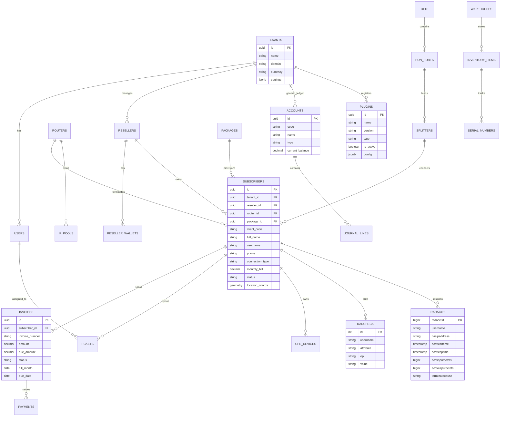

# IzanDesk ERP — Comprehensive Database Schema & Data Dictionary

**Database Engine:** PostgreSQL 16 (with PostGIS 3.4 & TimescaleDB extensions)  
**Data Layer:** TypeScript Type-Safe ORM (Prisma / Drizzle)  
**Architectural Scope:** Enterprise ISP ERP (Carrier-Grade BSS/OSS, Hot-Reload Plugins, Double-Entry Accounting, Inventory, GIS)  

---

## 1. High-Level System ERD



---

## 2. Comprehensive Table Definitions

### 2.1 Identity, Multi-Tenancy & Access Control
```sql
-- Multi-Tenant Organizations
CREATE TABLE tenants (
    id UUID PRIMARY KEY DEFAULT gen_random_uuid(),
    name VARCHAR(150) NOT NULL,
    subdomain VARCHAR(100) UNIQUE NOT NULL,
    currency VARCHAR(10) DEFAULT 'BDT',
    timezone VARCHAR(50) DEFAULT 'Asia/Dhaka',
    settings JSONB DEFAULT '{}',
    is_active BOOLEAN DEFAULT TRUE,
    created_at TIMESTAMPTZ DEFAULT NOW(),
    updated_at TIMESTAMPTZ DEFAULT NOW()
);

-- Administrative Users & Roles
CREATE TABLE users (
    id UUID PRIMARY KEY DEFAULT gen_random_uuid(),
    tenant_id UUID REFERENCES tenants(id) ON DELETE CASCADE,
    reseller_id UUID NULL, -- Null if ISP staff, populated if reseller staff
    name VARCHAR(150) NOT NULL,
    email VARCHAR(150) NOT NULL,
    password_hash VARCHAR(255) NOT NULL,
    phone VARCHAR(50),
    role VARCHAR(50) NOT NULL, -- SUPER_ADMIN, NOC_ENGINEER, BILLING_OPERATOR, TECHNICIAN, RESELLER
    permissions JSONB DEFAULT '[]',
    is_two_factor_enabled BOOLEAN DEFAULT FALSE,
    two_factor_secret VARCHAR(100),
    is_active BOOLEAN DEFAULT TRUE,
    last_login_at TIMESTAMPTZ,
    created_at TIMESTAMPTZ DEFAULT NOW(),
    updated_at TIMESTAMPTZ DEFAULT NOW(),
    UNIQUE(tenant_id, email)
);

-- Comprehensive Audit Trail
CREATE TABLE audit_logs (
    id BIGSERIAL PRIMARY KEY,
    tenant_id UUID REFERENCES tenants(id) ON DELETE CASCADE,
    user_id UUID REFERENCES users(id) ON DELETE SET NULL,
    action VARCHAR(100) NOT NULL, -- e.g. SUBSCRIBER_SUSPEND, BILL_WAIVED, ROUTER_REBOOT
    entity_type VARCHAR(100) NOT NULL,
    entity_id VARCHAR(100) NOT NULL,
    old_values JSONB,
    new_values JSONB,
    ip_address VARCHAR(45),
    user_agent TEXT,
    created_at TIMESTAMPTZ DEFAULT NOW()
);
```

### 2.2 Network Hardware, Routers & IPAM
```sql
-- Network Routers (MikroTik / CHR / CCR)
CREATE TABLE routers (
    id UUID PRIMARY KEY DEFAULT gen_random_uuid(),
    tenant_id UUID REFERENCES tenants(id) ON DELETE CASCADE,
    name VARCHAR(150) NOT NULL,
    ip_address VARCHAR(45) NOT NULL,
    api_port INT DEFAULT 8728,
    api_ssl_port INT DEFAULT 8729,
    rest_port INT DEFAULT 80,
    username VARCHAR(100) NOT NULL,
    password_encrypted TEXT NOT NULL,
    snmp_community VARCHAR(100) DEFAULT 'public',
    snmp_version VARCHAR(10) DEFAULT 'v2c',
    router_type VARCHAR(50) DEFAULT 'MIKROTIK', -- MIKROTIK_ROS6, MIKROTIK_ROS7, CISCO, HUAWEI
    nas_secret VARCHAR(100) NOT NULL, -- RADIUS shared secret
    is_active BOOLEAN DEFAULT TRUE,
    last_ping_status BOOLEAN DEFAULT FALSE,
    cpu_load INT DEFAULT 0,
    ram_usage_mb INT DEFAULT 0,
    uptime VARCHAR(50),
    created_at TIMESTAMPTZ DEFAULT NOW(),
    updated_at TIMESTAMPTZ DEFAULT NOW()
);

-- IP Address Management (IPAM) Pools
CREATE TABLE ip_pools (
    id UUID PRIMARY KEY DEFAULT gen_random_uuid(),
    tenant_id UUID REFERENCES tenants(id) ON DELETE CASCADE,
    router_id UUID REFERENCES routers(id) ON DELETE SET NULL,
    name VARCHAR(150) NOT NULL,
    subnet_cidr VARCHAR(50) NOT NULL, -- e.g. 10.100.0.0/22 or 103.150.x.x/28
    ip_version VARCHAR(10) DEFAULT 'IPv4', -- IPv4, IPv6
    pool_type VARCHAR(50) DEFAULT 'PRIVATE_CGNAT', -- PUBLIC_STATIC, PRIVATE_CGNAT, HOTSPOT
    gateway VARCHAR(45) NOT NULL,
    dns_primary VARCHAR(45) DEFAULT '1.1.1.1',
    dns_secondary VARCHAR(45) DEFAULT '8.8.8.8',
    total_ips INT NOT NULL,
    used_ips INT DEFAULT 0,
    is_active BOOLEAN DEFAULT TRUE,
    created_at TIMESTAMPTZ DEFAULT NOW()
);
```

### 2.3 FTTH, OLTs, PON Ports & GIS Fiber Map
```sql
-- Optical Line Terminals (OLT)
CREATE TABLE olts (
    id UUID PRIMARY KEY DEFAULT gen_random_uuid(),
    tenant_id UUID REFERENCES tenants(id) ON DELETE CASCADE,
    router_id UUID REFERENCES routers(id) ON DELETE SET NULL,
    name VARCHAR(150) NOT NULL,
    vendor VARCHAR(50) NOT NULL, -- HUAWEI, BDCOM, ZTE, CDATA, VSOL, HSGQ, ATOP
    hardware_model VARCHAR(100),
    ip_address VARCHAR(45) NOT NULL,
    telnet_port INT DEFAULT 23,
    ssh_port INT DEFAULT 22,
    snmp_community VARCHAR(100) DEFAULT 'public',
    username VARCHAR(100),
    password_encrypted TEXT,
    enable_password_encrypted TEXT,
    total_pon_ports INT DEFAULT 8,
    is_active BOOLEAN DEFAULT TRUE,
    last_poll_at TIMESTAMPTZ,
    created_at TIMESTAMPTZ DEFAULT NOW(),
    updated_at TIMESTAMPTZ DEFAULT NOW()
);

-- Physical PON Interfaces
CREATE TABLE pon_ports (
    id UUID PRIMARY KEY DEFAULT gen_random_uuid(),
    olt_id UUID REFERENCES olts(id) ON DELETE CASCADE,
    port_number VARCHAR(50) NOT NULL, -- e.g. "EPON0/1" or "GPON0/1/4"
    max_onus INT DEFAULT 64,
    connected_onus INT DEFAULT 0,
    optical_tx_power NUMERIC(6,2), -- dBm
    status VARCHAR(20) DEFAULT 'UP',
    created_at TIMESTAMPTZ DEFAULT NOW()
);

-- Geospatial Fiber Distribution Boxes (TJ Box / Splitters)
CREATE TABLE distribution_boxes (
    id UUID PRIMARY KEY DEFAULT gen_random_uuid(),
    tenant_id UUID REFERENCES tenants(id) ON DELETE CASCADE,
    pon_port_id UUID REFERENCES pon_ports(id) ON DELETE SET NULL,
    name VARCHAR(150) NOT NULL,
    box_code VARCHAR(50) UNIQUE NOT NULL,
    box_type VARCHAR(50) DEFAULT 'TJ_BOX', -- TJ_BOX, ODB, POLE_BOX, MANHOLE
    total_ports INT DEFAULT 16,
    used_ports INT DEFAULT 0,
    location_coords GEOMETRY(Point, 4326),
    address_description TEXT,
    key_info VARCHAR(100),
    created_at TIMESTAMPTZ DEFAULT NOW()
);

-- Optical Splitters
CREATE TABLE splitters (
    id UUID PRIMARY KEY DEFAULT gen_random_uuid(),
    distribution_box_id UUID REFERENCES distribution_boxes(id) ON DELETE CASCADE,
    ratio VARCHAR(20) NOT NULL, -- 1:2, 1:4, 1:8, 1:16, 1:32
    insertion_loss_db NUMERIC(5,2),
    upstream_core_color VARCHAR(30),
    created_at TIMESTAMPTZ DEFAULT NOW()
);

-- Fiber Cable Tracing Paths
CREATE TABLE fiber_cables (
    id UUID PRIMARY KEY DEFAULT gen_random_uuid(),
    tenant_id UUID REFERENCES tenants(id) ON DELETE CASCADE,
    name VARCHAR(150) NOT NULL,
    cable_type VARCHAR(50) DEFAULT 'AERIAL', -- AERIAL, UNDERGROUND, DUCT
    core_count INT DEFAULT 24, -- 4F, 12F, 24F, 48F, 96F
    start_point_box_id UUID REFERENCES distribution_boxes(id),
    end_point_box_id UUID REFERENCES distribution_boxes(id),
    cable_path_geom GEOMETRY(LineString, 4326),
    length_meters NUMERIC(10,2),
    created_at TIMESTAMPTZ DEFAULT NOW()
);
```

### 2.4 Bandwidth Packages & Policies
```sql
CREATE TABLE packages (
    id UUID PRIMARY KEY DEFAULT gen_random_uuid(),
    tenant_id UUID REFERENCES tenants(id) ON DELETE CASCADE,
    router_id UUID REFERENCES routers(id) ON DELETE SET NULL,
    name VARCHAR(150) NOT NULL,
    download_speed_kbps INT NOT NULL, -- e.g. 50000 for 50 Mbps
    upload_speed_kbps INT NOT NULL,
    burst_download_kbps INT DEFAULT 0,
    burst_upload_kbps INT DEFAULT 0,
    burst_threshold_kbps INT DEFAULT 0,
    burst_time_seconds INT DEFAULT 0,
    fup_quota_gb INT DEFAULT 0, -- 0 for unlimited
    fup_throttled_speed_kbps INT DEFAULT 0,
    default_price NUMERIC(12, 2) NOT NULL,
    validity_days INT DEFAULT 30,
    billing_type VARCHAR(30) DEFAULT 'PREPAID', -- PREPAID, POSTPAID
    mikrotik_rate_limit VARCHAR(100), -- "50M/50M"
    is_active BOOLEAN DEFAULT TRUE,
    created_at TIMESTAMPTZ DEFAULT NOW(),
    updated_at TIMESTAMPTZ DEFAULT NOW()
);
```

### 2.5 Subscribers & Customer Premises Equipment (TR-069)
```sql
CREATE TABLE subscribers (
    id UUID PRIMARY KEY DEFAULT gen_random_uuid(),
    tenant_id UUID REFERENCES tenants(id) ON DELETE CASCADE,
    reseller_id UUID NULL,
    router_id UUID REFERENCES routers(id) ON DELETE RESTRICT,
    package_id UUID REFERENCES packages(id) ON DELETE RESTRICT,
    distribution_box_id UUID REFERENCES distribution_boxes(id) ON DELETE SET NULL,
    client_code VARCHAR(50) UNIQUE NOT NULL,
    full_name VARCHAR(150) NOT NULL,
    username VARCHAR(100) UNIQUE NOT NULL, -- PPPoE / Hotspot Username
    password_hash VARCHAR(255) NOT NULL,
    phone VARCHAR(50) NOT NULL,
    alternate_phone VARCHAR(50),
    email VARCHAR(150),
    nid_passport_number VARCHAR(100),
    connection_type VARCHAR(50) DEFAULT 'PPPOE', -- PPPOE, STATIC_IP, HOTSPOT, LEASED_LINE
    ip_address VARCHAR(45),
    mac_address VARCHAR(30),
    monthly_bill NUMERIC(12, 2) NOT NULL,
    permanent_discount NUMERIC(12, 2) DEFAULT 0,
    current_due NUMERIC(12, 2) DEFAULT 0,
    expiry_date TIMESTAMPTZ NOT NULL,
    status VARCHAR(30) DEFAULT 'ACTIVE', -- ACTIVE, SUSPENDED, EXPIRED, PENDING, TERMINATED
    location_coords GEOMETRY(Point, 4326),
    installation_address TEXT,
    created_at TIMESTAMPTZ DEFAULT NOW(),
    updated_at TIMESTAMPTZ DEFAULT NOW()
);

-- TR-069 / GenieACS Managed Devices
CREATE TABLE cpe_devices (
    id UUID PRIMARY KEY DEFAULT gen_random_uuid(),
    subscriber_id UUID REFERENCES subscribers(id) ON DELETE CASCADE,
    device_id VARCHAR(255) UNIQUE NOT NULL, -- OUI-ProductClass-SerialNumber
    manufacturer VARCHAR(100),
    product_class VARCHAR(100),
    serial_number VARCHAR(100) NOT NULL,
    hardware_version VARCHAR(100),
    software_version VARCHAR(100),
    wifi_ssid VARCHAR(100),
    wifi_channel INT DEFAULT 0,
    optical_rx_power NUMERIC(6,2), -- dBm
    optical_tx_power NUMERIC(6,2),
    last_inform_at TIMESTAMPTZ,
    status VARCHAR(30) DEFAULT 'ONLINE',
    created_at TIMESTAMPTZ DEFAULT NOW(),
    updated_at TIMESTAMPTZ DEFAULT NOW()
);
```

### 2.6 FreeRADIUS AAA Tables
```sql
-- Standard FreeRADIUS Check Attributes
CREATE TABLE radcheck (
    id SERIAL PRIMARY KEY,
    username VARCHAR(64) NOT NULL DEFAULT '',
    attribute VARCHAR(64) NOT NULL DEFAULT '',
    op CHAR(2) NOT NULL DEFAULT '==',
    value VARCHAR(253) NOT NULL DEFAULT ''
);
CREATE INDEX radcheck_username_idx ON radcheck (username);

-- Standard FreeRADIUS Reply Attributes
CREATE TABLE radreply (
    id SERIAL PRIMARY KEY,
    username VARCHAR(64) NOT NULL DEFAULT '',
    attribute VARCHAR(64) NOT NULL DEFAULT '',
    op CHAR(2) NOT NULL DEFAULT '=',
    value VARCHAR(253) NOT NULL DEFAULT ''
);
CREATE INDEX radreply_username_idx ON radreply (username);

-- Standard FreeRADIUS User Group Mapping
CREATE TABLE radusergroup (
    id SERIAL PRIMARY KEY,
    username VARCHAR(64) NOT NULL DEFAULT '',
    groupname VARCHAR(64) NOT NULL DEFAULT '',
    priority INT NOT NULL DEFAULT 1
);
CREATE INDEX radusergroup_username_idx ON radusergroup (username);

-- High-Performance FreeRADIUS Accounting
CREATE TABLE radacct (
    radacctid BIGSERIAL PRIMARY KEY,
    acctsessionid VARCHAR(64) NOT NULL DEFAULT '',
    acctuniqueid VARCHAR(32) NOT NULL DEFAULT '',
    username VARCHAR(64) NOT NULL DEFAULT '',
    groupname VARCHAR(64) NOT NULL DEFAULT '',
    realm VARCHAR(64) DEFAULT '',
    nasipaddress VARCHAR(45) NOT NULL,
    nasportid VARCHAR(32) DEFAULT NULL,
    nasporttype VARCHAR(32) DEFAULT NULL,
    acctstarttime TIMESTAMPTZ DEFAULT NULL,
    acctupdatetime TIMESTAMPTZ DEFAULT NULL,
    acctstoptime TIMESTAMPTZ DEFAULT NULL,
    acctinterval INT DEFAULT NULL,
    acctsessiontime INT DEFAULT NULL,
    acctauthentic VARCHAR(32) DEFAULT NULL,
    connectinfo_start VARCHAR(50) DEFAULT NULL,
    connectinfo_stop VARCHAR(50) DEFAULT NULL,
    acctinputoctets BIGINT DEFAULT NULL,
    acctoutputoctets BIGINT DEFAULT NULL,
    calledstationid VARCHAR(50) NOT NULL DEFAULT '',
    callingstationid VARCHAR(50) NOT NULL DEFAULT '',
    acctterminatecause VARCHAR(32) NOT NULL DEFAULT '',
    servicetype VARCHAR(32) DEFAULT NULL,
    framedprotocol VARCHAR(32) DEFAULT NULL,
    framedipaddress VARCHAR(45) NOT NULL DEFAULT ''
);
CREATE INDEX radacct_username_idx ON radacct (username);
CREATE INDEX radacct_active_idx ON radacct (acctstoptime) WHERE acctstoptime IS NULL;
```

### 2.7 Invoicing, Billing & Payment Gateways
```sql
CREATE TABLE invoices (
    id UUID PRIMARY KEY DEFAULT gen_random_uuid(),
    tenant_id UUID REFERENCES tenants(id) ON DELETE CASCADE,
    subscriber_id UUID REFERENCES subscribers(id) ON DELETE CASCADE,
    invoice_number VARCHAR(100) UNIQUE NOT NULL,
    bill_month DATE NOT NULL,
    due_date DATE NOT NULL,
    subtotal NUMERIC(12, 2) NOT NULL,
    vat_amount NUMERIC(12, 2) DEFAULT 0,
    discount NUMERIC(12, 2) DEFAULT 0,
    total_amount NUMERIC(12, 2) NOT NULL,
    paid_amount NUMERIC(12, 2) DEFAULT 0,
    due_amount NUMERIC(12, 2) NOT NULL,
    status VARCHAR(30) DEFAULT 'UNPAID', -- UNPAID, PAID, PARTIAL, OVERDUE, VOID
    created_at TIMESTAMPTZ DEFAULT NOW(),
    updated_at TIMESTAMPTZ DEFAULT NOW()
);

CREATE TABLE payments (
    id UUID PRIMARY KEY DEFAULT gen_random_uuid(),
    tenant_id UUID REFERENCES tenants(id) ON DELETE CASCADE,
    invoice_id UUID REFERENCES invoices(id) ON DELETE SET NULL,
    subscriber_id UUID REFERENCES subscribers(id) ON DELETE CASCADE,
    transaction_id VARCHAR(150) UNIQUE NOT NULL,
    gateway VARCHAR(50) NOT NULL, -- BKASH_TOKENIZED, NAGAD_PGW, STRIPE, CASH, BANK
    amount NUMERIC(12, 2) NOT NULL,
    gateway_fee NUMERIC(12, 2) DEFAULT 0,
    net_amount NUMERIC(12, 2) NOT NULL,
    status VARCHAR(30) DEFAULT 'COMPLETED', -- COMPLETED, FAILED, REFUNDED
    webhook_payload JSONB DEFAULT '{}',
    payment_time TIMESTAMPTZ DEFAULT NOW()
);
```

### 2.8 Resellers & Multi-Tier Prepaid Wallets
```sql
CREATE TABLE resellers (
    id UUID PRIMARY KEY DEFAULT gen_random_uuid(),
    tenant_id UUID REFERENCES tenants(id) ON DELETE CASCADE,
    parent_reseller_id UUID NULL REFERENCES resellers(id), -- Null if direct under ISP
    business_name VARCHAR(150) NOT NULL,
    subdomain VARCHAR(100) UNIQUE,
    contact_person VARCHAR(150) NOT NULL,
    phone VARCHAR(50) NOT NULL,
    email VARCHAR(150),
    balance NUMERIC(12, 2) DEFAULT 0,
    credit_limit NUMERIC(12, 2) DEFAULT 0,
    is_active BOOLEAN DEFAULT TRUE,
    created_at TIMESTAMPTZ DEFAULT NOW(),
    updated_at TIMESTAMPTZ DEFAULT NOW()
);

CREATE TABLE reseller_package_prices (
    id UUID PRIMARY KEY DEFAULT gen_random_uuid(),
    reseller_id UUID REFERENCES resellers(id) ON DELETE CASCADE,
    package_id UUID REFERENCES packages(id) ON DELETE CASCADE,
    wholesale_buying_price NUMERIC(12, 2) NOT NULL,
    UNIQUE(reseller_id, package_id)
);

CREATE TABLE reseller_wallet_transactions (
    id UUID PRIMARY KEY DEFAULT gen_random_uuid(),
    reseller_id UUID REFERENCES resellers(id) ON DELETE CASCADE,
    transaction_type VARCHAR(50) NOT NULL, -- RECHARGE, CLIENT_RENEWAL, ADJUSTMENT, COMMISSION
    amount NUMERIC(12, 2) NOT NULL,
    balance_before NUMERIC(12, 2) NOT NULL,
    balance_after NUMERIC(12, 2) NOT NULL,
    reference_id VARCHAR(100),
    description TEXT,
    created_at TIMESTAMPTZ DEFAULT NOW()
);
```

### 2.9 General Ledger & Double-Entry Accounting
```sql
-- Chart of Accounts
CREATE TABLE accounts (
    id UUID PRIMARY KEY DEFAULT gen_random_uuid(),
    tenant_id UUID REFERENCES tenants(id) ON DELETE CASCADE,
    code VARCHAR(50) NOT NULL, -- e.g. 1001 (Cash), 1002 (Bank), 4001 (Subscription Revenue)
    name VARCHAR(150) NOT NULL,
    account_type VARCHAR(50) NOT NULL, -- ASSET, LIABILITY, EQUITY, REVENUE, EXPENSE
    current_balance NUMERIC(14, 2) DEFAULT 0,
    is_active BOOLEAN DEFAULT TRUE,
    UNIQUE(tenant_id, code)
);

-- Journal Entries
CREATE TABLE journal_entries (
    id UUID PRIMARY KEY DEFAULT gen_random_uuid(),
    tenant_id UUID REFERENCES tenants(id) ON DELETE CASCADE,
    entry_number VARCHAR(100) UNIQUE NOT NULL,
    entry_date DATE NOT NULL,
    reference VARCHAR(150),
    memo TEXT,
    created_by UUID REFERENCES users(id),
    created_at TIMESTAMPTZ DEFAULT NOW()
);

-- Individual Debit/Credit Lines
CREATE TABLE journal_lines (
    id UUID PRIMARY KEY DEFAULT gen_random_uuid(),
    journal_entry_id UUID REFERENCES journal_entries(id) ON DELETE CASCADE,
    account_id UUID REFERENCES accounts(id) ON DELETE RESTRICT,
    debit_amount NUMERIC(12, 2) DEFAULT 0,
    credit_amount NUMERIC(12, 2) DEFAULT 0,
    description VARCHAR(255)
);
```

### 2.10 Inventory, Serial Numbers & Warehouses
```sql
CREATE TABLE warehouses (
    id UUID PRIMARY KEY DEFAULT gen_random_uuid(),
    tenant_id UUID REFERENCES tenants(id) ON DELETE CASCADE,
    name VARCHAR(150) NOT NULL,
    location VARCHAR(255),
    is_primary BOOLEAN DEFAULT FALSE
);

CREATE TABLE inventory_items (
    id UUID PRIMARY KEY DEFAULT gen_random_uuid(),
    tenant_id UUID REFERENCES tenants(id) ON DELETE CASCADE,
    category VARCHAR(50) NOT NULL, -- ONT, ROUTER, FIBER_CABLE, SFP, SPLICER
    model_name VARCHAR(150) NOT NULL,
    unit_of_measure VARCHAR(30) DEFAULT 'PCS', -- PCS, METERS
    unit_cost NUMERIC(12, 2) NOT NULL,
    min_stock_alert INT DEFAULT 10
);

CREATE TABLE serial_numbers (
    id UUID PRIMARY KEY DEFAULT gen_random_uuid(),
    inventory_item_id UUID REFERENCES inventory_items(id) ON DELETE CASCADE,
    warehouse_id UUID REFERENCES warehouses(id) ON DELETE RESTRICT,
    assigned_subscriber_id UUID REFERENCES subscribers(id) ON DELETE SET NULL,
    assigned_technician_id UUID REFERENCES users(id) ON DELETE SET NULL,
    serial_number VARCHAR(150) UNIQUE NOT NULL,
    mac_address VARCHAR(30),
    status VARCHAR(50) DEFAULT 'IN_STOCK', -- IN_STOCK, ASSIGNED_CLIENT, DEFECTIVE_RMA, SCRAPPED
    created_at TIMESTAMPTZ DEFAULT NOW(),
    updated_at TIMESTAMPTZ DEFAULT NOW()
);
```

### 2.11 Dynamic Hot-Reload Plugin Registry
```sql
CREATE TABLE plugins (
    id UUID PRIMARY KEY DEFAULT gen_random_uuid(),
    name VARCHAR(100) UNIQUE NOT NULL, -- e.g. "plugin-bkash-pgw", "driver-huawei-olt"
    title VARCHAR(150) NOT NULL,
    version VARCHAR(30) NOT NULL,
    plugin_type VARCHAR(50) NOT NULL, -- PAYMENT_GATEWAY, SMS_GATEWAY, OLT_DRIVER, CUSTOM_HOOK
    entry_file VARCHAR(255) NOT NULL, -- "plugins/payment-bkash/index.js"
    is_active BOOLEAN DEFAULT TRUE,
    config JSONB DEFAULT '{}',
    schema JSONB DEFAULT '{}', -- UI schema for dynamic settings forms
    loaded_at TIMESTAMPTZ,
    last_reload_status VARCHAR(50) DEFAULT 'OK',
    created_at TIMESTAMPTZ DEFAULT NOW()
);
```
