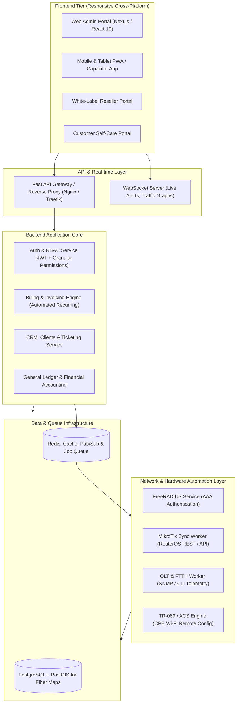

# IzanDesk: ISP ERP Research & Architecture Blueprint

## 1. Executive Summary

**IzanDesk** is envisioned as a next-generation, all-in-one ERP platform tailored for Internet Service Providers (ISPs), Fiber-to-the-Home (FTTH) operators, and Wireless ISPs (WISPs). 

To ensure IzanDesk surpasses legacy solutions, we performed:
1. **Live System Inspection** of the reference platform [CIS Complete ISP Solution](https://demo.cisbd.net) (evaluating database patterns, UI/UX structure, MikroTik API routines, OLT integration, billing lifecycle, and reseller hierarchy).
2. **Industry Benchmark Research** against international market leaders (**Splynx**, **Sonar Software**, **Powercode**, and **daloRADIUS/FreeRADIUS**).
3. **Architectural Blueprints** for an enterprise-grade, plug-and-play, responsive system (Web, Tablet, Mobile, Desktop PWA).

---

## 2. Deep-Dive Inspection of Reference System (CIS Complete ISP Solution)

Through live analysis of `demo.cisbd.net`, we mapped the existing operational flows, features, and systemic limitations:

### 2.1 Core Modules Identified in Reference Platform

```mermaid
mindmap
  root((CIS Complete ISP Solution))
    Subscriber Management
      Home & Corporate (BW) Clients
      PPPoE / Static IP / Hotspot
      MAC Binding & Live Polling
      KYC, Documents & Geo Locations
    Network & Hardware
      MikroTik RouterOS API / REST
      PPPoE Audit & Duplicate Detection
      Bandwidth Profiles / Queues
      OLT & ONU Optical Power (Huawei, BDCOM, VSOL, ZTE)
    Billing & Financials
      Prepaid & Postpaid Invoicing
      Automated Monthly Batch Generation
      Due Analytics & Auto-Suspend Rules
      Upstream IIG / NTTN Billing
      Cash, Bank & MFS (bKash/Nagad/Rocket)
    Reseller & Sub-ISP
      Tiered Reseller Packages
      Wholesale Margin Pricing
      Reseller Prepaid Wallets & Settlements
    Support & CRM
      Trouble Ticketing & SLA
      Technician Task Assignment
      Client Portal Notices & Marquee
    Omnichannel Messaging
      SMS Gateway & Bulk Dispatch
      Telegram Bot Integration
      Personal MFS SMS Webhook Listener
    HR & Administration
      Employee Profiles & Payroll
      Attendance Tracking
      Audit Trail & Database Backup
```

### 2.2 Strengths vs. Weaknesses of Reference Solution

| Feature Area | Reference Solution (CISBD) | IzanDesk Target Upgrade |
| :--- | :--- | :--- |
| **User Interface (UI/UX)** | Monolithic server-rendered PHP/Blade template with Bootstrap/Tabler. Dense, cluttered tables, heavy full-page reloads. | **Modern React/Next.js SPA/PWA**, dark/light mode, fluid animations (Framer Motion), command bar (`Cmd+K`), mobile/tablet responsive touch ergonomics. |
| **Hardware Integration** | Direct synchronous MikroTik API and Telnet/SNMP CLI polling. Slow when router list grows. | **Asynchronous event-driven worker engine** (Redis BullMQ / Celery), RADIUS AAA with CoA (Change of Authorization) for instant disconnects/upgrades. |
| **OLT / FTTH Monitoring** | Basic optical power check via manual Telnet/SNMP templates. | **Automated ONU discovery, visual PON port capacity mapping, real-time optical power (Rx/Tx) telemetry graphs, and signal degradation alerts.** |
| **Billing & Automated Suspension** | Cron-based daily billing script; simple router enable/disable. | **Multi-cycle flexible billing** (calendar month, anniversary 30-day, hourly prepaid), automated grace periods, walled garden redirection, and smart auto-reconnection upon payment. |
| **Payment Gateways** | Primarily regional Bangladesh MFS (bKash, Nagad) + SMS scraper. | **Plug-and-play payment gateway driver system**: Regional MFS (bKash, Nagad, Rocket), International (Stripe, PayPal, Razorpay, Paystack), plus Automated Bank Feeds. |
| **Reseller Architecture** | Basic reseller balance and client listing. | **Multi-tenant hierarchical billing** (Franchise, Sub-ISP, Reseller) with independent sub-domain white-labeling, commission wallets, and granular permission controls. |
| **Deployment & Portability** | Manual LAMP/LEMP server setup, complex environment dependencies. | **Single-command "Plug-and-Play" Docker Compose deployment**, automated migrations, built-in health checks, zero-friction updates. |

---

## 3. High-Level System Architecture for IzanDesk

To achieve true scalability, real-time reactivity, and cross-platform compatibility, IzanDesk is structured around an **API-first, modular service architecture**:



---

## 4. Key Functional Modules Specification

### Module 1: Subscriber & Lifecycle Management
- **Client Onboarding**: Fast KYC verification, NID/Passport upload, custom client ID prefixes, automatic contract/welcome generation.
- **Connection Types**: PPPoE, Static IP (DHCP Option 82 / IP-Binding), Hotspot (Voucher/PIN based), Dedicated Bandwidth (CIR Leased Lines).
- **GIS Geo-Mapping**: Interactive map with customer pins, fiber distribution boxes (TJ boxes, splitters, ODBs), and cable routes with click-to-route fiber trace.
- **Live Diagnostics**: Ping, traceroute, live bandwidth consumption graphs, MAC binding, remote reboot, and one-click disconnect.

### Module 2: Automated Billing & Multi-Currency Engine
- **Flexible Billing Cycles**: Calendar monthly (1st of month), 30-day recurring anniversary, pay-as-you-go / prepaid daily, and burstable corporate billing.
- **Automated Collection & Suspension**: Grace periods, automated reminder notifications before due date, instant non-payment auto-suspend, and instant reactivation upon payment confirmation.
- **Walled Garden**: Non-paying subscribers redirected to a customized captive portal page allowing one-click payment to restore instant internet access.
- **Corporate Bandwidth (BW) Invoicing**: Dedicated CIR/MIR bandwidth invoices with custom tax/VAT rates, itemized hardware rental, and SLA metrics.

### Module 3: Network Hardware Integration (OSS)
- **MikroTik RouterOS Integration**:
  - Compatible with RouterOS v6 and v7 (REST API, RouterOS API protocol, and RADIUS).
  - Automated Simple Queues, Queue Trees, Address Lists, and PPP Secrets.
  - Live interface and user traffic graphing without overloading router CPU.
- **OLT / FTTH Management**:
  - Support for major vendors: Huawei, BDCOM, ZTE, CDATA, VSOL, HSGQ, C-Data, Fiberhome.
  - Auto-discovery of unconfigured ONUs with one-click authorization and profile binding.
  - Optical power signal levels (Rx/Tx optical power) monitoring with warning thresholds for degrading fiber cores.
- **IPAM (IP Address Management)**:
  - IPv4 and IPv6 subnet management, pool utilization tracking, conflict detection, and public/private NAT allocation logs.

### Module 4: Reseller & Franchisee Ecosystem
- **Multi-Level Distribution**: Super-Admin $\rightarrow$ Master Franchise $\rightarrow$ Sub-ISP / Reseller $\rightarrow$ Sub-Reseller.
- **Wallet Architecture**: Prepaid recharge credit system. Resellers purchase credit balances and allocate packages to customers; balance is deducted automatically.
- **Custom Wholesale Rates**: Define custom buying rates per package for each reseller, tracking profit margins and commissions.
- **Independent Reseller Branding**: White-labeled reseller login, custom invoices, and localized SMS sender IDs.

### Module 5: Helpdesk, Field Operations & CRM
- **SLA-Based Ticketing**: Auto-assignment based on zones and technician availability.
- **Field Engineer Mobile Interface**: Responsive mobile views for technicians to accept repair tickets, view customer optical power, perform speed tests, and update ticket resolution notes on-site.
- **Inventory & Asset Tracking**: Track routers, ONUs/ONTs, patch cords, optical splitters, and splicers across technicians and central warehouses.

### Module 6: Omnichannel Communication & Self-Care
- **Notification Gateways**: Multi-provider SMS gateway (custom HTTP API, Twilio, Infobip, regional gateways), WhatsApp Business API, Telegram bot, and Email (SMTP/SES).
- **Customer Self-Service Portal**: Mobile-responsive portal and PWA where customers can:
  - Check subscription status, data usage, and invoice history.
  - Pay instantly via embedded payment gateway.
  - Test connection speed.
  - Change their home Wi-Fi password (via TR-069 ACS).
  - Open and monitor support tickets.

---

## 5. Technology Stack Comparison & Recommendation

To ensure IzanDesk is **scalable, easy to self-host ("plug-and-play"), and responsive**:

| Layer | Recommended Choice | Rationale |
| :--- | :--- | :--- |
| **Frontend** | **Next.js 15 / React 19 + Tailwind CSS + Shadcn UI** | High performance, server-side rendering for portals, rich component ecosystem, fully responsive for desktop, tablet, and mobile. Can be packaged as Desktop app (Tauri/Electron) or Mobile app (Capacitor/PWA). |
| **Backend API** | **Node.js (NestJS / TypeScript) or Python (FastAPI)** | High concurrency for handling thousands of concurrent network polling tasks, clean modular architecture, rich networking libraries for MikroTik and SNMP. |
| **Database** | **PostgreSQL 16 + PostGIS** | Enterprise relational data integrity for financial transactions, plus native PostGIS for fiber/node geospatial mapping. |
| **Caching & Queues** | **Redis 7 + BullMQ** | Fast in-memory state, distributed locking, and reliable background job scheduling for billing cycles and network polls. |
| **Network Core** | **FreeRADIUS 3 + Net-SNMP + RouterOS API Client** | Standard carrier-grade AAA authentication and network device telemetry. |
| **Packaging** | **Docker & Docker Compose** | One-command deployment (`docker compose up -d`), multi-platform support, zero dependency conflicts on customer servers. |

---

## 6. Phased Implementation Roadmap

To ensure high accuracy, rigorous quality control, and browser verification after every phase:


1. **Phase 1: Project Scaffolding, Core UI/UX Design System & Auth (Browser Verified)**
   - Initialize project workspace with Dockerized setup.
   - Design system: Modern dark/light theme, typography, responsive navigation, command palette.
   - User authentication, multi-role RBAC (Super Admin, Manager, Billing Operator, Technician, Reseller).
2. **Phase 2: Subscriber & Inventory Management (Browser Verified)**
   - Client lifecycle CRUD (Home, Corporate, Bandwidth).
   - Zone, Area, Box, and POP hierarchy.
   - KYC documents, contract generation, client status management.
3. **Phase 3: Network Engine & Hardware Integration (Browser Verified)**
   - MikroTik RouterOS API integration (router management, package synchronization, live bandwidth graphs).
   - OLT / FTTH management (vendor profiles, PON port mapping, optical power telemetry).
   - IPAM subnet and pool allocation.
4. **Phase 4: Automated Billing, Wallets & Payment Gateways (Browser Verified)**
   - Automated monthly invoice generator and recurring billing scheduler.
   - Automated suspension / auto-disconnect policies.
   - Payment gateway drivers (MFS, card, cash ledger) and instant reactivation.
5. **Phase 5: Reseller System, Helpdesk CRM & Messaging (Browser Verified)**
   - Reseller hierarchical pricing and prepaid wallet system.
   - Trouble ticket dispatch with SLA tracking.
   - SMS, WhatsApp, and Telegram alert triggers.
6. **Phase 6: Customer Self-Service Portal, PWA Polish & 1-Click Installer (Browser Verified)**
   - Dedicated customer self-service web & mobile PWA.
   - Full system health diagnostics and 1-click `docker-compose` production release.
