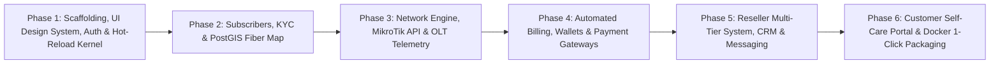

# IzanDesk ERP — Master Implementation Roadmap & Verification Plan

**Development Methodology:** Incremental, Test-Driven, Browser-Verified after every Phase  
**Architecture (current implementation):** Monorepo (pnpm workspaces), Next.js 16 / React 19 (App Router), Express 5 + TypeScript API with `ws`, PostgreSQL 16/PostGIS, Redis 7, in-process DB-locked schedulers, Hot-Reload Plugin Kernel. Earlier research described NestJS/Socket.IO/BullMQ; those are not used by the running code.
**Dev Server Web Host:** Localhost (`http://localhost:3000`)  

---

## 1. Monorepo Directory Layout

```text
/home/server/izandesk/
├── docker/
│   ├── docker-compose.yml           # Unified multi-container orchestration
│   ├── web/Dockerfile               # Next.js 16 frontend container
│   ├── api/Dockerfile               # Express 5 backend API container
│   ├── radius/                      # FreeRADIUS 3 config, dictionary, and SQL maps
│   └── wg-hub/                      # WireGuard hub container/config (hub-and-spoke overlay)
├── plugins/                         # Dynamic Hot-Reload Plugin Workspace
│   ├── payment-bkash/               # bKash Tokenized Checkout Plugin
│   ├── payment-stripe/              # Stripe Elements & Cards Plugin
│   ├── sms-greenweb/                # Bangladesh Local SMS Gateway Plugin
│   ├── payment-nagad/               # Nagad merchant checkout
│   ├── payment-paypal/              # PayPal Smart Buttons
│   ├── payment-rocket/              # Rocket merchant checkout
│   └── olt-huawei/                  # Huawei GPON/EPON Driver Plugin
├── apps/
│   ├── web/                         # Next.js 16 App Router Frontend
│   │   ├── src/
│   │   │   ├── app/                 # Routes (Dashboard, Clients, Billing, Network, Tickets)
│   │   │   ├── components/          # Shadcn UI, Telemetry Charts, Cmd+K Command Palette
│   │   │   └── lib/                 # State management, API clients, WebSocket listeners
│   └── api/                         # Express 5 Backend Application
│       ├── src/
│       │   ├── kernel/              # Dynamic Hot-Reload Plugin Kernel & Hook Bus
│       │   ├── db/                  # Raw SQL bootstrap/migrations (source of truth)
│       │   ├── routes/              # Core BSS/OSS HTTP modules
│       │   └── integrations/        # Billing, network, messaging and periodic schedulers
├── packages/
│   ├── shared-types/                # Shared TypeScript DTOs, Enums & Interfaces
│   └── config/                      # Shared ESLint, Prettier, Tailwind configurations
└── README.md
```

---

## 2. Phase-by-Phase Roadmap & Browser Verification Milestones



---

### Phase 1: Project Scaffolding, "Neo-Telecom" UI/UX Design System, Auth & Hot-Reload Plugin Kernel
- **Status:** Implemented in codebase (pending/ready for browser verification in target environment)
- **Engineering Deliverables**:
  1. Monorepo workspace initialization using `pnpm` (`apps/web`, `apps/api`, `packages/shared-types`, `plugins/`).
  2. Implement the **Hot-Reload Plugin Kernel** with `chokidar` file watcher and dynamic module loader, lifecycle hooks/event bus, plugin status metadata, and API exposure/reload controls (`apps/api/src/kernel/plugin-manager.ts`, `/api/plugins`).
  3. "Neo-Telecom" UI Design System:
     - Dark and Light modes with Obsidian black and Crisp porcelain white surfaces.
     - Responsive Desktop collapsible sidebar + Mobile bottom navigation bar.
     - Global Command Bar (`Cmd+K` / `Ctrl+K`) for fast universal search.
  4. Multi-Role RBAC Authentication Shell (Super Admin, NOC Engineer, Billing Operator, Technician, Reseller) with real login/session (JWT), protected app shell, and server-backed auth endpoints.
  5. Interactive Executive Dashboard with real-time KPI metrics, active subscriber gauges, and bandwidth throughput area charts, plus live hot-reload plugin kernel status.
- **Browser Verification Milestone**:
  - Open `http://localhost:3000` (or configured remote/public URL) in browser.
  - Test multi-role login (and role perspective switching in UI).
  - Verify responsive layout across Desktop, Tablet, and Mobile viewports.
  - Test dark/light mode toggle and `Cmd+K` keyboard shortcut.
  - Verify hot-reload plugin status indicator and reload actions on the dashboard.
- **Notes:** Web uses same-origin `/api` proxy to API; deployment hosts/origins/secrets are environment-configured (no hardcoded deployment IPs). Use `apps/web/.env.example` and `apps/api/.env.example`.

---

### Phase 2: Subscriber & Inventory Management (BSS Core)
- **Status:** Implemented in codebase (DB/API/UI wired; browser verification ready)
- **Engineering Deliverables**:
  1. Complete Subscriber CRUD (Home, Corporate CIR, Hotspot) with advanced **wizard** onboarding/edit, PPPoE/connection profiles, validation, lifecycle status, topology and geo-location fields (`/api/subscribers`, `/subscribers`).
  2. KYC Document storage/upload/list (NID, Passport, Contract, etc.) and automatic Client Code Generator on subscriber creation.
  3. Physical topology hierarchy: Area → Zone → Distribution Box (TJ/Splitter/FAT/FDB/Closure) with management APIs and linkage to subscribers (`/api/topology/*`).
  4. Location & GIS: PostGIS-backed data, MapLibre GL interactive map (local no-key `gis-basemap.json`) with subscriber pins, fiber boxes, fiber routes, add-distribution-box placement, route drawing, trace-to-subscriber flow, and subscriber **map pin picker** with **satellite+label views** (free no-key alternatives) and layer switching, **current-location** capture plus **reverse-geocoded auto-fill** (district, thana/upazila, post office, village, area, ward, road/street, house, address) (`/api/gis/*`, `/gis`, `/subscribers`).
  5. Hardware Inventory & Serial Number Tracking: warehouses, items (ONT/Router/Fiber/etc.), serials with status/assignment to subscribers and stock summaries (`/api/inventory/*`, `/inventory`).
- **Browser Verification Milestone**:
  - Add/edit subscribers via wizard with PPPoE profiles, verify validation and auto client-code generation.
  - Pick/pin location on map (or use current location) and confirm address fields auto-fill and save.
  - View interactive GIS map, add a distribution box, and trace a fiber line to a subscriber residence.
  - Search and filter subscribers instantly; upload/view KYC documents; manage inventory warehouses/items/serials.

---

### Phase 3: Network OSS, MikroTik RouterOS API & OLT Telemetry
- **Status:** Implemented
- **Engineering Deliverables**:
  1. **Dual-mode router/NAS management:** per-router integration method `API`, `REST`, or `RADIUS` with mode-specific fields; RADIUS-mode stores **per-NAS shared secret** and **CoA port** (per router) (`/api/network/routers`, `/routers`).
  2. **Dual-mode subscriber provisioning & per-subscriber RouterOS binding:** wizard assignment as **Specific Router (API/REST)** or **RADIUS (all RADIUS-enabled routers/NAS pool)** (`provisioning_mode`, `router_id`, `/subscribers`). For ROUTER-mode subscribers, PPP secrets are **created/updated/removed on the assigned MikroTik** (API/REST) on subscriber create/update/delete/move, with package/profile resolution and enabled/disabled state sync.
  3. **Real MikroTik RouterOS (API/REST):** real connectivity/test, live identity & resource telemetry (CPU/RAM/uptime/board), active PPP session presence/uptime, and best-effort per-session traffic rates for direct routers. Live throughput/session streaming via **SSE** (`/api/network/sessions/stream`) and **WebSocket** (`/api/network/sessions/ws`, token-authenticated) (`/api/network/routers`, `/api/network/sessions`, `/routers`). (Self-signed HTTPS handled best-effort.)
  4. **Bandwidth & QoS packages:** CRUD and **real sync/provisioning to direct API/REST MikroTik routers** (PPP profile rate-limits + simple queue templates) with sync status/error reporting (`/api/network/packages`, `/api/network/packages/sync`, `/bandwidth`). Queue Tree/PCQ and per-subscriber queue bindings are supported via profile/template-based provisioning; behavior may vary by RouterOS version/config.
  5. **FreeRADIUS integrated (docker stack):** `freeradius` service (UDP 1812/1813) with PostgreSQL SQL backend and IzanDesk-managed tables (`radcheck`, `radreply`, `radgroupcheck`, `radgroupreply`, `radusergroup`, `radacct`, `radpostauth`, `nas`) — config in `docker/radius/`, compose in `docker/docker-compose.yml`. FR3-compatible SQL query structure and `authorize_*` column order (`attribute,value,op`) are configured; `filter_username`/`suffix` are disabled to accept non-FQDN usernames (e.g. `user@site`).
  6. **Real RADIUS/AAA, Accounting & CoA:** subscriber sync writes real FreeRADIUS SQL (`radcheck`/`radreply`/`radusergroup`) (`/api/radius/sync`, `/radius`); **RFC3576 CoA/PoD** sends real UDP packets to the target NAS using stored per-router secret & CoA port (`/api/radius/coa`). Accounting start/interim-update/stop is recorded to `radacct`; live RADIUS/accounted sessions are overlaid from `radacct` when accounting data is received. Live PPPoE/RADIUS auth (PAP/SQL, e.g. `Mikrotik-Group`) and `radacct` start/stop with session time, octets, IP and terminate cause have been validated in a real flow; `radpostauth` logging may vary by flow/config.
  7. **NAS auto-sync:** RADIUS-mode routers auto-sync to FreeRADIUS `nas` table on create/update/delete; bulk `POST /api/network/routers/sync-radius-nas` (FreeRADIUS may require reload/restart to pick up SQL client changes). Additional observed NAS source clients can be registered to accept real auth/acct traffic.
  8. **WireGuard overlay for NAT/CGNAT sites (plug-and-play):** IzanDesk-managed hub-and-spoke tunnel (`wg-hub` service/container, configurable hub endpoint/UDP port and overlay CIDR, DB-driven hub/peer config in `wg_hub_config`/`wg_peers`) to reach/manage MikroTik routers without public IPs and OLTs behind them (`/api/wireguard`, `/wireguard`). Peers provision to MikroTik via API/REST when reachable or via RouterOS v7 bootstrap scripts (spoke dials out with keepalive), with per-peer tunnel/allowed routes and declared OLT management CIDRs.
  9. **FTTH OLT Manager (Huawei, BDCOM, ZTE, VSOL, CDATA):** OLT CRUD/test, ONU discovery, 1-click authorize with subscriber linking, and optical Rx/Tx dBm telemetry with color-coded thresholds (`/api/olt/*`, `/olts`) via an **SNMP-capable, tunnel-aware adapter** (real SNMP test/discovery/telemetry attempts when SNMP tools, access, and vendor/model OID/index mapping are available, including polling via the WireGuard path; safe fallback when unavailable). Real vendor mappings (best-effort): **VSOL V1600D (EPON)** — IF-MIB ONU discovery with online/offline status plus optical Rx/Tx (dBm) and MAC enrichment; **BDCOM P3310C (EPON)** — IF-MIB `EPON0/x:y` discovery with online/offline status, ONU MAC, RX/TX optical (dBm, vendor MIB), distance (m, best-effort), description/name, and last-down timestamp enrichment. (Explicit distance units/Tx scaling and alarm/down-cause codes may require MIB/manual or CLI confirmation.)
- **Browser/Operational Verification Milestone**:
  - Add real router/NAS in `API`/`REST`/`RADIUS` mode, run **Test**, and view live telemetry/sessions for API/REST in `/routers`.
  - Create subscribers with **Specific Router (API/REST)** or **RADIUS pool** provisioning in `/subscribers` and verify PPP secret provisioning/removal on direct routers.
  - Create/sync bandwidth packages in `/bandwidth` (direct-router targets).
  - Sync RADIUS users, execute CoA/PoD, and validate auth/acct/NAS behavior in `/radius` (with MikroTik RADIUS/incoming, accounting, and firewall configured).
  - Configure hub/peers in `/wireguard`, bring `wg-hub` online (UDP reachable), provision/bootstrap a NATed MikroTik spoke, and verify handshake + reachability to OLT management over the tunnel.
  - Test/discover/authorize ONUs and verify optical telemetry in `/olts` (real SNMP when configured/tools available, including over WireGuard; fallback otherwise).
  - Consume live sessions via SSE or WebSocket endpoint.
- **Notes:** Real end-to-end behavior depends on device/network configuration and tooling (MikroTik API/REST services, RADIUS 1812/1813 accounting/auth reachability and matching NAS clients/secrets, CoA 3799, OLT SNMP/CLI access with vendor/model OID/index mappings, and WireGuard UDP reachability/routing/firewall with correct site routes/ACLs). Accounting-driven sessions/rates require NAS accounting packets. Advanced OLT per-ONU fields/operations depend on vendor/model-specific mappings (and tunnel routing for NATed sites). FreeRADIUS SQL client changes may require container reload/restart. MikroTik PPP profile/rate-limit values must be valid for dynamic queue creation (e.g. burst-rate >= max-rate when bursting is configured). Client-side PPP/LCP keepalive loss or weak optical signal (e.g. low ONU RX dBm) can drop established sessions independently of RADIUS/provisioning.

---

### Phase 4: Automated Billing, Due Policies & Payment Gateways
- **Status:** Implemented (gap-hardened)
- **Engineering Deliverables**:
  1. Automated Monthly Invoicing Engine: Batch invoice generator with prorated mid-month calculations, invoice items/records, and due recalculation.
  2. Multi-stage due policy engine & scheduler: Pre-expiry warning, grace countdown, and overdue suspension/isolation with **DB-locked periodic evaluation** (idempotent-ish sweep), status/log tracking.
  3. Walled Garden / restricted-access enforcement: policy-driven walled-garden stage with **MikroTik restricted PPP profile provisioning** (e.g. `izn-walled-garden`), **RADIUS reply attributes** (`Mikrotik-Address-List`, `Mikrotik-Rate-Limit`, group/message) and **RFC3576 CoA/PoD** (CoA with fallback disconnect/reconnect) for immediate effect. *(Full captive redirect requires corresponding address-list/firewall/DNS/NAT/hotspot rules on the NAS/router.)*
  4. Dual-Mode Payment Gateway Drivers (Hot-Reloadable Plugins):
     - bKash Tokenized Checkout & Personal MFS SMS Listener hook.
     - Nagad Merchant PGW & Rocket adapters.
     - Stripe Elements (Cards, Apple Pay/Google Pay) & PayPal Smart Buttons.
  5. Payment hardening & ingestion: checkout/confirm/webhook APIs with **idempotent processing** (event/trx/payment_ref dedupe), **webhook signature/token verification** when secrets configured, and **MFS SMS ingestion endpoint** (`/api/billing/payments/sms/ingest`, plugin parsing + auto-match).
  6. Instant auto-reactivation restoring full bandwidth on confirmed/cleared payment (PPP/RADIUS/CoA/profile restore) with measured duration (target < 2s).
- **Browser/Operational Verification Milestone**:
  - Run batch billing generation (`/billing`) and confirm prorated invoices.
  - Evaluate due policies / trigger suspension-walled-garden and verify restricted provisioning state, RADIUS/CoA enforcement and logs.
  - Complete sandbox checkout+confirm or post a gateway webhook; verify idempotent payment recording and instant reactivation when dues are cleared.
  - Ingest a bKash/personal MFS SMS payload (authenticated or `MFS_SMS_INGEST_TOKEN`) and verify parse/match/recording behavior.
  - Configure and manage payment gateways from the UI (`/plugins`, `/plugins/payment-gateways/*`) and verify runtime config/enablement.
- **Notes:** Core Phase 4 capabilities are implemented in code/UI. Live end-to-end validation (real overdue/payment enforcement, NAS captive redirect for walled-garden traffic, signed/provider webhooks and credentials, MFS forwarder/token, and <2s reactivation on active sessions) depends on NAS/device configuration and external gateway/SMS integration setup.

---

### Phase 5: Reseller Multi-Tier System, CRM & Omnichannel Messaging
- **Status:** Implemented (code-complete foundation with automation & integration hooks)
- **Engineering Deliverables**:
  1. Multi-Tier Reseller management and portal data model with white-label branding fields (subdomain/custom domain, brand, colors/logo/title), reseller-scoped views/APIs, dynamic reseller pages (`/resellers`, `/resellers/add`, `/resellers/[id]`), and subscriber counts/status/session stats.
  2. Reseller Prepaid Wallet: balance recharge, wholesale buying margin calculations, wallet transaction ledger, and subscriber renewal with auto-deduction/payment recording.
  3. Subscriber ownership/linkage: subscribers can be assigned to own ISP or a specific reseller in onboarding/edit flows and reflected in reseller scoping/stats.
  4. SLA-Driven Trouble Ticketing (CRM): ticket lifecycle, priority-based SLA due/breach tracking, technician assignment/dispatch, comments/activity, site/GPS navigation links, mobile-friendly resolution workflow, access scoping, and event notifications.
  5. Omnichannel Messaging Engine:
     - Channel/config/template/log models and gateway tester with live provider dispatch attempts (GreenWeb, Twilio, WhatsApp Cloud, Telegram Bot) when credentials are configured (safe simulated fallback otherwise).
     - Invoice/payment/ticket/messaging hooks and scheduled sweeps for due reminders and daily revenue summaries (best-effort) with delivery logs.
     - Invoice HTML/PDF/share endpoints (`/api/billing/invoices/:id/{html,pdf,share}`) for invoice links/PDF delivery.
  6. White-label host resolution: Next.js host middleware and branding resolve API (`/api/branding/resolve`) for subdomain/custom-domain mapping (runtime serving requires DNS/reverse-proxy host mapping).
- **Browser/Operational Verification Milestone**:
  - Create reseller, open reseller page from dynamic drawer, and verify subscriber counts/status breakdown. ✅
  - Log in as Reseller, check wallet balance, and renew a subscriber using reseller credit. ✅
  - Add/edit subscriber with ownership (Own/Reseller) and verify reseller linkage. ✅
  - Submit/assign/resolve a support ticket and verify scoped access/GPS workflow. ✅
  - Dispatch a test SMS/WhatsApp/Telegram message from Gateway Tester and review logs. ✅ (live delivery depends on provider credentials/config)
- **Notes:** Live external delivery (GreenWeb/Twilio/Meta WhatsApp/Telegram), signed webhook/provider setup, and automated outreach require valid credentials/tokens, approved senders/templates, and environment connectivity. White-label subdomain/custom-domain serving requires DNS and reverse-proxy (e.g. Caddy) host mapping; branding resolution hooks are implemented.

---

### Phase 6: Customer Self-Care Portal & 1-Click Plug-and-Play Packaging
- **Status:** Implemented foundation (portal PWA, invoices/payments, speedtest and Wi-Fi tabs, system health/backup UI; advanced TR-069 automation remains provider/config dependent).
- **Engineering Deliverables**:
  1. Customer Self-Service Portal (PWA):
     - View subscription status, invoice history, and instant online payment.
     - Live bandwidth speedtest.
     - Wi-Fi SSID and password modification via TR-069 GenieACS.
  2. Complete Docker Compose package: single command startup (`docker compose -f docker/docker-compose.yml up -d`).
  3. System health diagnostics and automated database backup engine.
- **Browser Verification Milestone**:
  - Open customer self-care view on mobile browser, view bill, make payment, and view Wi-Fi settings.
  - Verify complete system health diagnostics.

---

### Phase 7: Finance, HRM, Reporting & Commercial Operations (Roadmap Extension)
- **Status:** Implemented (foundation in codebase; Phase 7 DB schema, APIs, and UI modules added; advanced workflows/integrations remain environment- and priority-dependent)
- **Comparison context (high level):**
  - **ShohozBill demo (https://demo.shohozbill.com, login-gated):** public access shows unified admin/staff/reseller operations login and branded portal entry; authenticated module-level comparison was not possible without in-session UI access. Phase 7 targets important ISP operations commonly expected in ShohozBill-class platforms that are not yet first-class in IzanDesk.
  - **Important capabilities already present in IzanDesk:** subscriber onboarding/CRM & lifecycle, PPPoE/package & bandwidth management, live sessions, MikroTik router/NAS, RADIUS/AAA & CoA, WireGuard overlay, OLT/ONU telemetry hooks, GIS/fiber mapping & topology, inventory/serial tracking, billing/invoicing/due policies/walled-garden, multi-gateway payments (bKash/Nagad/Rocket/Stripe/PayPal) with callback/webhook/sms-ingest hooks, reseller multi-tier & wallet, trouble tickets/SLA, omnichannel messaging, plugins/hot-reload kernel, customer self-care portal (PWA, invoices/payments/speedtest/Wi-Fi hooks), system health/diagnostics and backup engine, Docker Compose packaging.
- **Engineering Deliverables**:
  1. **Accounts & Finance (Double-entry-lite):** income/expense tracking, chart of accounts, vouchers/receipts, collections & dues aging reports, payment reconciliation, cash/bank/MFS ledgers, and exportable financial statements.
  2. **HRM & Payroll:** employee/staff profiles & roles, attendance/leave, salary structures, payroll runs, commissions/incentives (technicians/collectors/resellers), and activity/audit trails.
  3. **Procurement & Asset Management:** vendors/suppliers, purchase orders & bills, stock-in/out with cost tracking, asset register & depreciation basics, and tighter linkage to inventory/warehouse/serial assignment.
  4. **Hotspot/Voucher & Retail Sales:** prepaid voucher/card generation, hotspot plans, sales/activation tracking, and reconciliation with payments/subscriber services where applicable.
  5. **Advanced Reporting & Analytics:** configurable operational/financial reports (collection, churn/expiry, package/revenue, reseller performance, ticket SLA, usage/FUP), dashboards, scheduled/email delivery, CSV/PDF exports, and date/area/reseller filters.
  6. **Field/Agent & Workflow Enhancements:** collector/technician mobile workflows, route/visit planning, proof-of-payment/collection capture, richer ticket/job dispatch, and notification/escalation rules.
  7. **Compliance, Audit & Integrations:** comprehensive audit logs, role/permission hardening, document templates, API/webhook extensibility, and integrations (accounting/tax, SMS/payment providers, external BI) as needed.
- **Browser/Operational Verification Milestone**:
  - Record income/expense and reconcile collections; generate aging and monthly financial reports with exports.
  - Run HR/payroll workflow for staff and verify attendance/commission calculations.
  - Create vendor purchase, receive stock/assets, and validate inventory/cost updates.
  - Generate/sell hotspot vouchers and verify activation/reconciliation (if enabled).
  - Produce and export key operational reports (collections, expiry, reseller, SLA) and validate filters/schedules.
- **Notes:** Scope should be phased by priority and validated against target ISP workflows. Some capabilities (e.g. hotspot, advanced accounting/tax, field collection) depend on network topology, regulatory needs, and third-party integrations.
