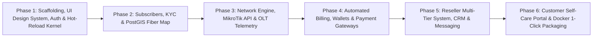

# IzanDesk ERP — Master Implementation Roadmap & Verification Plan

**Development Methodology:** Incremental, Test-Driven, Browser-Verified after every Phase  
**Architecture:** Monorepo (pnpm workspaces), Next.js 15, NestJS, PostgreSQL 16, Redis 7, Hot-Reload Plugin Kernel  
**Dev Server Web Host:** Localhost (`http://localhost:3000`)  

---

## 1. Monorepo Directory Layout

```text
/home/server/izandesk/
├── docker/
│   ├── docker-compose.yml           # Unified multi-container orchestration
│   ├── Dockerfile.web               # Next.js 15 frontend container
│   ├── Dockerfile.api               # NestJS backend API container
│   └── radius/                      # FreeRADIUS 3 config, dictionary, and SQL maps
├── plugins/                         # Dynamic Hot-Reload Plugin Workspace
│   ├── payment-bkash/               # bKash Tokenized Checkout Plugin
│   ├── payment-stripe/              # Stripe Elements & Cards Plugin
│   ├── sms-greenweb/                # Bangladesh Local SMS Gateway Plugin
│   ├── sms-twilio/                  # Twilio International SMS Plugin
│   └── olt-huawei/                  # Huawei GPON/EPON Driver Plugin
├── apps/
│   ├── web/                         # Next.js 15 App Router Frontend
│   │   ├── src/
│   │   │   ├── app/                 # Routes (Dashboard, Clients, Billing, Network, Tickets)
│   │   │   ├── components/          # Shadcn UI, Telemetry Charts, Cmd+K Command Palette
│   │   │   └── lib/                 # State management, API clients, WebSocket listeners
│   └── api/                         # NestJS Backend Application
│       ├── src/
│       │   ├── kernel/              # Dynamic Hot-Reload Plugin Kernel & Hook Bus
│       │   ├── modules/             # Core BSS/OSS Modules (Auth, Subscribers, Billing, etc.)
│       │   ├── workers/             # BullMQ Background Job Workers
│       │   └── prisma/              # Prisma / Drizzle Schema & Seeders
├── packages/
│   ├── shared-types/                # Shared TypeScript DTOs, Enums & Interfaces
│   └── config/                      # Shared ESLint, Prettier, Tailwind configurations
└── README.md
```

---

## 2. Phase-by-Phase Roadmap & Browser Verification Milestones



---

### Phase 1: Project Scaffolding, "Neo-Telecom" UI/UX Design System, Auth & Hot-Reload Plugin Kernel
- **Engineering Deliverables**:
  1. Monorepo workspace initialization using `pnpm` (`apps/web`, `apps/api`, `packages/shared-types`, `plugins/`).
  2. Implement the **Hot-Reload Plugin Kernel** with `chokidar` file watcher and dynamic module loader.
  3. "Neo-Telecom" UI Design System:
     - Dark and Light modes with Obsidian black and Crisp porcelain white surfaces.
     - Responsive Desktop collapsible sidebar + Mobile bottom navigation bar.
     - Global Command Bar (`Cmd+K` / `Ctrl+K`) for fast universal search.
  4. Multi-Role RBAC Authentication Shell (Super Admin, NOC Engineer, Billing Operator, Technician, Reseller).
  5. Interactive Executive Dashboard with real-time KPI metrics, active subscriber gauges, and bandwidth throughput area charts.
- **Browser Verification Milestone**:
  - Open `http://localhost:3000` in browser.
  - Test multi-role login switches.
  - Verify responsive layout across Desktop, Tablet, and Mobile viewports.
  - Test dark/light mode toggle and `Cmd+K` keyboard shortcut.
  - Verify hot-reload plugin status indicator on the dashboard.

---

### Phase 2: Subscriber & Inventory Management (BSS Core)
- **Engineering Deliverables**:
  1. Complete Subscriber CRUD (Home, Corporate Leased Line CIR, Hotspot).
  2. KYC Document storage (NID, Passport, Contract) and custom Client Code Generator.
  3. Physical topology hierarchy: Area $\rightarrow$ Zone $\rightarrow$ Distribution Box (TJ / Splitter).
  4. PostGIS / Leaflet interactive GIS map with subscriber pins, fiber boxes, and cable route tracing.
  5. Hardware Inventory & Serial Number Tracking (Warehouses, ONTs, Routers, Fiber Drums).
- **Browser Verification Milestone**:
  - Add new subscribers with PPPoE profiles, verify validation and auto client-code generation.
  - View interactive GIS map, add a distribution box, and trace a fiber line to a subscriber residence.
  - Search and filter subscribers with instant client-side reactivity (zero page-reloads).

---

### Phase 3: Network OSS, MikroTik RouterOS API & OLT Telemetry
- **Engineering Deliverables**:
  1. MikroTik RouterOS manager (API port 8728/8729 & v7 REST) with live CPU/RAM/Uptime telemetry.
  2. Dynamic Bandwidth Package sync (Simple Queues, Queue Trees, Burst limits).
  3. Live subscriber throughput stream (Rx/Tx) via WebSockets.
  4. FTTH OLT Manager (Huawei, BDCOM, ZTE, VSOL, CDATA):
     - Unconfigured ONU auto-discovery and 1-click authorization.
     - Live optical power telemetry (Rx/Tx dBm) with color-coded warning thresholds.
  5. Carrier-Grade FreeRADIUS 3 AAA integration:
     - Auto-sync to `radcheck` / `radreply` tables.
     - RFC 3576 Dynamic CoA / PoD execution for on-the-fly speed adjustments.
- **Browser Verification Milestone**:
  - Inspect managed routers and view live throughput meters in the browser.
  - Inspect OLTs, authorize an ONU, and verify color-coded optical power levels.

---

### Phase 4: Automated Billing, Due Policies & Payment Gateways
- **Engineering Deliverables**:
  1. Automated Monthly Invoicing Engine: Batch invoice generator with prorated mid-month calculations.
  2. Multi-stage auto-suspension state machine: Pre-expiry warning, grace period countdown, and router isolation.
  3. Walled Garden redirection mechanism for non-paying users.
  4. Dual-Mode Payment Gateway Drivers (Hot-Reloadable Plugins):
     - bKash Tokenized Checkout & Personal MFS SMS Listener.
     - Nagad Merchant PGW & Rocket adapters.
     - Stripe Elements (Cards, Apple Pay) & PayPal Smart Buttons.
  5. Instant auto-reactivation restoring full bandwidth in <2 seconds upon payment confirmation.
- **Browser Verification Milestone**:
  - Run the batch billing generator to create invoices for a billing cycle.
  - Trigger auto-suspend on an overdue test account; verify status flips to "Suspended".
  - Simulate a payment via sandbox gateway; verify instant status restoration to "Active".

---

### Phase 5: Reseller Multi-Tier System, CRM & Omnichannel Messaging
- **Engineering Deliverables**:
  1. Multi-Tier Reseller Portal with white-label branding and custom subdomain routing.
  2. Reseller Prepaid Wallet: Balance recharge, wholesale buying margin calculations, and auto-deduction.
  3. SLA-Driven Trouble Ticketing: Automated technician dispatch, mobile field view, and GPS navigation.
  4. Omnichannel Messaging Engine:
     - Local Bangladesh SMS gateways & Twilio international SMS.
     - WhatsApp Business API with dynamic invoice PDF delivery.
     - Telegram Bot for NOC alerts and daily executive revenue summaries.
- **Browser Verification Milestone**:
  - Log in as Reseller, check wallet balance, and renew a subscriber using reseller credit.
  - Submit a support ticket, assign to technician, and verify mobile resolution view.
  - Dispatch a test SMS from the built-in Gateway Tester.

---

### Phase 6: Customer Self-Care Portal & 1-Click Plug-and-Play Packaging
- **Engineering Deliverables**:
  1. Customer Self-Service Portal (PWA):
     - View subscription status, invoice history, and instant online payment.
     - Live bandwidth speedtest.
     - Wi-Fi SSID and password modification via TR-069 GenieACS.
  2. Complete Docker Compose package: Single command startup (`docker compose up -d`).
  3. System health diagnostics and automated database backup engine.
- **Browser Verification Milestone**:
  - Open customer self-care view on mobile browser, view bill, make payment, and view Wi-Fi settings.
  - Verify complete system health diagnostics.
