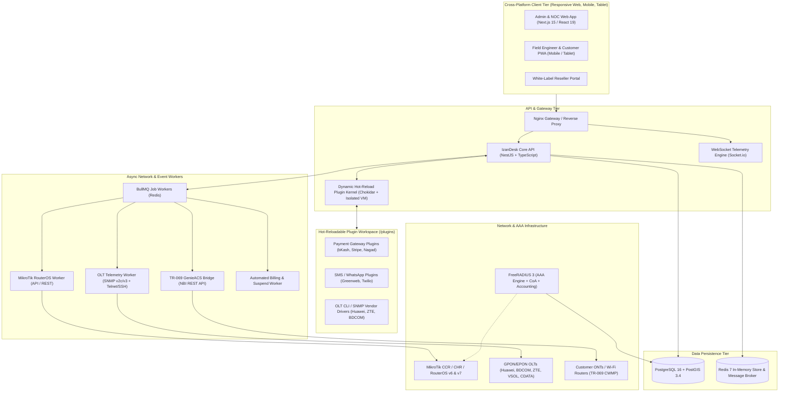
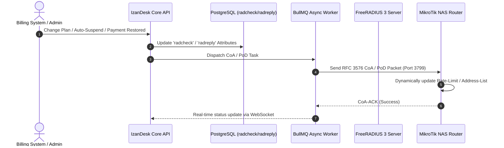
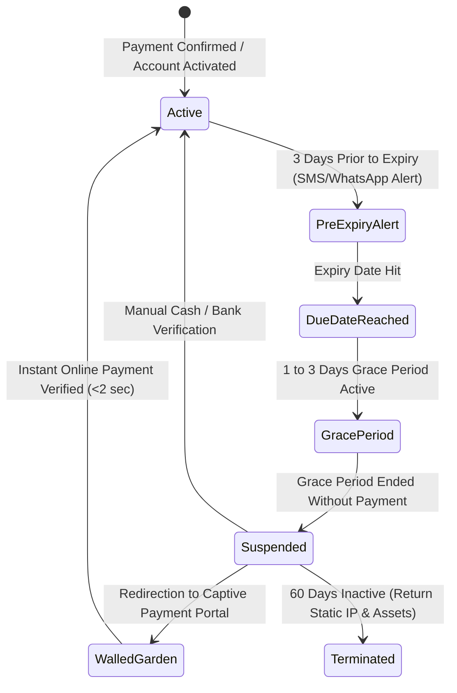

# IzanDesk ERP — Software Requirements Specification (SRS) & Architecture

**Document Version:** 1.2.0  
**Project:** IzanDesk ERP (ISP Billing & Network Management)  
**Status:** Approved Master Architecture  
**Key Features:** 565 Built-in Production Features across 18 Domains  
**Extensibility:** Dynamic Hot-Reload Plugin Kernel (Zero-Downtime Extensibility)  

---

## 1. System Scope & Core Tenets

**IzanDesk** is an all-in-one, plug-and-play Enterprise Resource Planning (ERP) platform designed for Internet Service Providers (ISPs), Fiber-to-the-Home (FTTH) network operators, and Wireless ISPs (WISPs). 

It merges **Business Support Systems (BSS)** (automated recurring billing, multi-gateway payments, reseller wallets, double-entry financial accounting, HR/payroll, and CRM ticketing) with **Operations Support Systems (OSS)** (carrier-grade FreeRADIUS 3 AAA, MikroTik RouterOS automation, OLT/FTTH optical telemetry, TR-069 GenieACS remote customer CPE Wi-Fi management, and PostGIS fiber route mapping).

### Core Architectural Pillars
1. **565 Built-In Production Features**: Comprehensive feature matrix covering every operational requirement of modern telecom operators (refer to [izandesk_500_plus_feature_catalog.md](file:///home/server/.gemini/antigravity-cli/brain/4e3267c3-6afb-4476-8d07-d635bee4cd39/izandesk_500_plus_feature_catalog.md)).
2. **Dynamic Hot-Reload Plugin Kernel**: New payment gateway drivers, SMS gateways, and OLT vendor CLI templates can be dropped into the `/plugins/` directory and hot-reloaded dynamically without restarting the server or interrupting active subscriber sessions.
3. **Carrier-Grade AAA with Dynamic CoA**: FreeRADIUS 3.2 integrated with dynamic Change of Authorization (CoA RFC 3576) and Packet of Disconnect (PoD) for real-time speed transitions and instant suspension/reactivation.
4. **Dual-Market Extensibility**: Complete regional MFS integration (bKash tokenized, Nagad PGW, Rocket, SSLCommerz, Android SMS listener app, BTRC regulatory reports) and international networks (Stripe, PayPal, M-Pesa, Twilio).
5. **"Neo-Telecom" Responsive UI/UX**: Ultra-modern dark and light themes, Linear/Vercel-inspired clean aesthetics, subtle glassmorphism, instant keyboard command palette (`Cmd+K`), real-time WebSocket traffic graphs, and seamless mobile bottom navigation.
6. **1-Click Plug-and-Play Deployment**: Containerized with Docker and Docker Compose for zero-friction self-hosted deployment on any standard Linux server.

---

## 2. High-Level Modular Architecture



---

## 3. Dynamic Hot-Reload Plugin Kernel Specification

### 3.1 Kernel Design
The IzanDesk Plugin Kernel allows adding, upgrading, or modifying drivers without restarting the core ERP process.

1. **Hot-Reload Lifecycle**:
   - The kernel initializes a file system watcher (`chokidar`) targeting `/home/server/izandesk/plugins/`.
   - When a plugin file is modified, added, or deleted, the kernel triggers `hotReloadPlugin(pluginId)`.
   - The plugin's module cache in Node.js `require.cache` or dynamic `import()` cache is evicted.
   - The newly updated plugin is re-instantiated and validated against its contract interface.
   - The active hook registry is re-bound in under 50 milliseconds with zero dropped HTTP requests.
2. **Standard Driver Contracts**:
   - **`PaymentGatewayDriver`**:
     ```typescript
     export interface PaymentGatewayDriver {
       id: string;
       name: string;
       version: string;
       createCheckoutSession(invoice: InvoiceDto): Promise<CheckoutSessionDto>;
       verifyWebhook(req: HttpRequest): Promise<PaymentVerificationResult>;
       queryTransaction(trxId: string): Promise<TransactionDetailsDto>;
     }
     ```
   - **`SmsGatewayDriver`**:
     ```typescript
     export interface SmsGatewayDriver {
       id: string;
       name: string;
       sendSms(recipient: string, message: string, senderId?: string): Promise<SmsDispatchResult>;
       checkBalance(): Promise<SmsBalanceDto>;
     }
     ```
   - **`OltVendorDriver`**:
     ```typescript
     export interface OltVendorDriver {
       vendor: string;
       getOnuOpticalPower(oltIp: string, ponPort: string, onuId: string): Promise<OpticalReadingDto>;
       authorizeOnu(oltIp: string, onuSerial: string, profile: LineProfileDto): Promise<boolean>;
       rebootOnu(oltIp: string, ponPort: string, onuId: string): Promise<boolean>;
     }
     ```

---

## 4. Hardware AAA & Subscriber Telemetry Specifications

### 4.1 Carrier-Grade RADIUS & Dynamic CoA Sequence


### 4.2 TR-069 / GenieACS Customer Wi-Fi Remote Management
- **Zero-Touch Provisioning (ZTP)**: On connection, the customer router issues a CWMP Inform request. IzanDesk automatically maps the serial number to the subscriber's account and injects PPPoE credentials and Wi-Fi SSID.
- **Remote Wi-Fi Password Changes**: Directly updates the `InternetGatewayDevice.LANDevice.1.WLANConfiguration.1.PreSharedKey.1.PreSharedKey` parameter tree.
- **Signal Quality Telemetry**: Automatically queries the optical module transceiver parameters (`RxOpticalPower`, `TxOpticalPower`) and graphs signal fluctuations over time.

---

## 5. Billing & Automated Policy Engine

### 5.1 Billing Lifecycle State Machine


- **Instant Auto-Reactivation**: Upon payment confirmation (bKash webhook, Stripe notification, or cash entry), the system automatically updates the subscriber status, issues a RADIUS CoA disconnect packet, and restores full high-speed bandwidth in less than 2 seconds without human intervention.
- **Walled Garden Enforcement**: Suspended users are added to the router's `Suspended_Users` address list or assigned a restricted RADIUS profile. Any HTTP web browsing is immediately redirected to the payment landing page.

---

## 6. Complete Data Schema Synchronization

All 565 features are backed by the relational PostgreSQL 16 schema detailed in:  
📄 **[izandesk_database_schema_and_models.md](file:///home/server/.gemini/antigravity-cli/brain/4e3267c3-6afb-4476-8d07-d635bee4cd39/izandesk_database_schema_and_models.md)**
